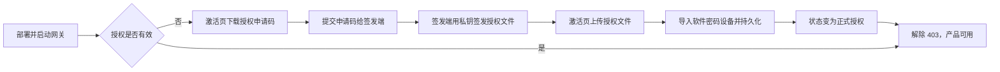

# AI Token 网关软件授权流程

| 项目 | 内容 |
| --- | --- |
| 文档版本 | v1.0 |
| 更新日期 | 2026-11-01 |
| 适用分支 | `zayk-dev`（提交 `253b42b5b8` 及之后） |
| 适用产品 | AI Token 网关（LiteLLM 定制版） |
| 参考实现 | ccsp `ccsp-auth` 授权模块、`ccsp-system` 系统授权信息展示 |

## 1. 概述

AI Token 网关采用软件授权模式：产品在完成授权前只能访问激活页面、登录页和健康检查，所有业务接口返回 403；授权文件与本机绑定，由签发端（持有厂商私钥）针对本机生成的申请码签发后导入生效。

授权功能与 LiteLLM 企业版 License（`LITELLM_LICENSE`）相互独立，不要混淆。

核心特征：

- 软件授权，不依赖加密卡等硬件设备
- 机器绑定：授权文件只对生成申请码的那台机器有效
- 授权信息集中展示：产品名称、版本、产品序列号、授权状态、有效期、授权日期等
- 支持长期授权（永久）与起止日期授权（到期自动拦截）
- 原生库危险操作隔离在子进程，异常不会导致网关进程崩溃

## 2. 术语

| 术语 | 含义 |
| --- | --- |
| 授权申请码 | 由网关本机 `liblicense.so` 根据机器信息生成的一串十六进制文本，用于换取授权 |
| 授权文件 / 授权响应文件 | 签发端根据申请码生成、由网关导入的十六进制文本文件 |
| 产品序列号 | 授权信息中展示的序列号，默认由本机机器指纹派生，可用环境变量覆盖 |
| 机器码 | 本机机器指纹派生标识，默认与产品序列号一致 |
| 签发端 | 持有授权私钥和签发工具的一方，负责把申请码签发成授权文件 |
| 软件设备 | `liblicense.so` 内部维护的软件密码设备，授权导入后保存在设备中 |

## 3. 授权原理



处理链路：

1. 网关启动时读取持久化授权文件并尝试导入，随后查询软件设备授权信息
2. 未授权时门禁中间件拦截产品流量，只放行激活相关接口
3. 管理员在激活页下载申请码，申请码由 `liblicense.so` 生成，包含本机机器信息与随机信息
4. 签发端用私钥对申请码签发授权文件
5. 管理员上传授权文件，网关校验十六进制格式后交给 `liblicense.so` 导入
6. 导入成功且授权状态有效（未过期、未到生效时间、非未授权）后写入持久化文件，状态变为“正式授权”
7. 之后每次启动自动重新导入持久化文件，不依赖容器内部临时文件

### 3.1 原生库调用隔离

`liblicense.so` 是较旧的厂商库，实测在“先生成申请码、再导入格式错误的授权文件”时会发生段错误（signal 11）。因此：

- 查询授权信息（只读）在网关进程内执行，可安全高频调用
- 生成申请码、导入授权文件在短生命周期的子进程 `native_worker` 中执行
- 子进程崩溃只影响本次授权操作，网关进程保持运行，接口返回 400 并记录日志

### 3.2 授权状态判定

| 条件 | 状态 | 展示文案 | 是否放行 |
| --- | --- | --- | --- |
| 软件设备中授权版本号为 0 | `unauthorized` | 未授权 | 否 |
| 生效时间等于失效时间 | `authorized` | 正式授权 | 是，有效期为“长期有效” |
| 当前时间早于生效时间 | `not_yet_valid` | 未生效 | 否 |
| 当前时间晚于失效时间 | `expired` | 已过期 | 否 |
| 原生库可用但读取授权信息异常 | `invalid` | 授权无效 | 否 |
| 原生库缺失或无法加载 | `component_unavailable` | 授权组件不可用 | 否 |

> 说明：未安装授权时 `License_GetLicenseInfo` 会返回非零错误码，网关按全零授权信息处理，与 ccsp 拦截器的行为一致，最终展示“未授权”而不是“授权无效”。

## 4. 前置条件

1. 部署环境为 Linux x86-64（原生库为 Linux x86-64 构建）
2. 网关版本包含软件授权功能（`zayk-dev` 分支对应提交）
3. 签发端具备授权签发工具与私钥，并且签发工具的产品类型与网关 `LITELLM_PRODUCT_CODE` 一致
4. 授权文件持久化目录可写，并在容器重建后保留（建议挂载数据卷）
5. 生产环境不要关闭授权强制开关

## 5. 部署配置

### 5.1 必需文件

| 文件 | 说明 |
| --- | --- |
| `litellm/proxy/product_license/lib/liblicense.so` | 随镜像内置的原生授权库 |
| 授权持久化文件（如 `/app/data/product_license.lic`） | 导入成功后自动生成，需放在持久化卷中 |

### 5.2 环境变量

| 变量 | 默认值 | 说明 |
| --- | --- | --- |
| `LITELLM_PRODUCT_LICENSE_ENABLED` | `true` | 授权强制开关。仅本地开发可设 `false` |
| `LITELLM_PRODUCT_LICENSE_FILE` | `./product_license.lic` | 授权文件持久化路径，容器部署必须指向持久化卷 |
| `LITELLM_PRODUCT_LICENSE_LIB` | 内置库目录优先，其次常见系统路径 | 显式指定 `liblicense.so` 路径 |
| `LITELLM_PRODUCT_NAME` | `AI Token网关` | 授权信息中展示的产品名称 |
| `LITELLM_PRODUCT_VERSION` | LiteLLM 包版本 | 授权信息中展示的产品版本 |
| `LITELLM_PRODUCT_SERIAL` | 由机器指纹派生 | 覆盖展示的产品序列号，便于与采购记录对应 |
| `LITELLM_PRODUCT_CODE` | `ai-token-gateway` | 生成申请码时上报的产品/服务类型，需与签发端约定一致 |

### 5.3 docker compose 参考配置

```yaml
services:
  litellm:
    environment:
      LITELLM_PRODUCT_LICENSE_ENABLED: "True"
      LITELLM_PRODUCT_LICENSE_FILE: "/app/data/product_license.lic"
      LITELLM_PRODUCT_NAME: "AI Token网关"
    volumes:
      - product_license_data:/app/data

volumes:
  product_license_data:
    name: litellm_product_license_data
```

## 6. 授权操作流程

### 6.1 确认当前授权状态

浏览器打开激活页，或调用接口：

```bash
curl -s http://<网关地址>/product/license/info
```

未授权时的典型响应：

```json
{
  "product_name": "AI Token网关",
  "product_version": "1.106.0",
  "serial_number": "17E4-95EC-8553-2F54",
  "status": "未授权",
  "time": "暂无信息",
  "create_time": "暂无信息",
  "auth_state": "unauthorized",
  "machine_code": "17E4-95EC-8553-2F54",
  "license_version": 0,
  "native_available": true,
  "license_file": "/app/data/product_license.lic",
  "message": "该系统未被授权，请导入授权文件"
}
```

重点确认：

- `native_available` 必须为 `true`，否则先解决原生库问题
- `auth_state` 为 `unauthorized` 表示尚未授权
- 记录 `serial_number`，用于与采购/签发记录核对

### 6.2 获取授权申请码

方式一：激活页

1. 浏览器访问 `http://<网关地址>/ui/license-activation/`
2. 点击“下载授权申请码”
3. 得到 `product_license_request.txt`

方式二：接口下载

```bash
curl -s -o product_license_request.txt \
  http://<网关地址>/product/license/request
```

申请码说明：

- 纯十六进制文本，无文件头，不要手工修改
- 单次典型长度约 1684 字节（3368 个十六进制字符），不同机器略有差异
- 每次生成的内容不同（包含随机信息），但都对应同一台机器的签发请求
- 拿到其他机器上签发无效，必须使用本机生成的申请码

校验文件是否为合法十六进制文本：

```bash
tr -d '[:xdigit:]' < product_license_request.txt | wc -c   # 期望输出 0
```

### 6.3 提交签发

1. 将 `product_license_request.txt` 交给签发端
2. 签发端使用厂商签发工具和私钥，按申请码生成授权文件
3. 授权文件同样为十六进制文本，文件名建议 `product_license.lic.txt`
4. 签发时确认产品类型与 `LITELLM_PRODUCT_CODE` 一致
5. 保存好授权文件原件，便于后续重新导入或审计

### 6.4 导入授权文件

方式一：激活页

1. 回到 `http://<网关地址>/ui/license-activation/`
2. 点击“上传授权文件”，选择签发端返回的授权文件
3. 页面提示“授权成功”并自动展示正式授权信息

方式二：接口导入

```bash
curl -s -X POST \
  -F "file=@product_license.lic.txt" \
  http://<网关地址>/product/license/import
```

成功响应示例：

```json
{
  "message": "授权成功",
  "license": {
    "status": "正式授权",
    "auth_state": "authorized",
    "serial_number": "17E4-95EC-8553-2F54",
    "time": "长期有效",
    "create_time": "2026-10-30 10:00:00"
  }
}
```

导入成功后：

- 授权文件被持久化到 `LITELLM_PRODUCT_LICENSE_FILE`
- 门禁立即解除，无需重启

### 6.5 验证授权结果

```bash
# 1. 授权状态应为 authorized / 正式授权
curl -s http://<网关地址>/product/license/info

# 2. 业务接口不再返回 403 product_not_authorized
curl -s -o /dev/null -w "%{http_code}\n" http://<网关地址>/v1/models
```

验证标准：

| 检查项 | 未授权 | 已授权 |
| --- | --- | --- |
| `/product/license/info` 的 `auth_state` | `unauthorized` | `authorized` |
| `/product/license/info` 的 `status` | 未授权 | 正式授权 |
| `/v1/models`（无 Key） | 403 `product_not_authorized` | 401 鉴权失败（说明门禁已放行） |
| 管理台页面 | 302 跳转激活页 | 正常进入 |
| `/ui/license-activation/` | 200 激活页 | 200，展示已授权信息 |

## 7. 门禁行为

未授权时，网关按以下规则处理请求：

| 请求类型 | 行为 |
| --- | --- |
| 业务接口、管理接口 | 403，响应体 `error.type = product_not_authorized` |
| 浏览器页面请求 | 302 跳转 `/ui/license-activation/` |
| WebSocket 连接 | 以 1008 关闭 |
| `/product/license/*` | 放行 |
| `/health*`、`/metrics` | 放行 |
| 登录相关：`/login`、`/v2/login`、`/logout`、`/sso*` | 放行 |
| `/.well-known/*`、`/get_image`、`/get_favicon`、`/favicon.ico` | 放行 |
| 文档：`/docs`、`/redoc`、`/openapi.json`、`/swagger` | 放行 |
| 前端静态资源：`/ui` 下的 `_next` 资源、`.js/.css/.png` 等文件 | 放行 |
| 登录页 `/ui/login`、激活页 `/ui/license-activation` | 放行 |
| 其他前端页面（如 `/ui/settings`） | 302 跳转激活页 |

授权成功后全部放行。授权接口在未授权状态可匿名访问，这是激活流程的必需设计；授权文件必须由签发端针对本机签发，无法通过上传文件解锁其他机器。

## 8. 授权信息展示

管理台路径：`Settings > 授权信息`，对应页面 `/ui/product-license/`。

| 展示字段 | 说明 |
| --- | --- |
| 产品名称 | `LITELLM_PRODUCT_NAME`，默认 AI Token网关 |
| 产品版本 | `LITELLM_PRODUCT_VERSION`，默认网关版本 |
| 产品序列号 | 默认由机器指纹派生，可用 `LITELLM_PRODUCT_SERIAL` 覆盖 |
| 机器码 | 本机机器指纹派生标识 |
| 授权状态 | 正式授权 / 未授权 / 已过期 / 未生效 / 授权无效 / 授权组件不可用 |
| 有效期 | 长期有效，或“开始时间 至 结束时间” |
| 授权日期 | 授权生效日期 |
| 授权版本 | 授权文件中的版本号 |
| 授权用户数 / 线程数 | 授权文件中的用户数与线程数限制 |
| 用户描述 | 授权文件中的用户描述 |
| 授权文件 | 持久化文件路径 |

## 9. 运维操作

### 9.1 备份与恢复

备份 `LITELLM_PRODUCT_LICENSE_FILE` 指向的授权文件即可。恢复时把文件放回原路径，重启网关后自动重新导入。

### 9.2 容器重建与升级

- 授权信息在容器内软件设备中是临时的，恢复来源是持久化授权文件
- 重建/升级容器时必须保留授权文件所在的数据卷和环境变量
- 启动日志出现 `product license not active: 该系统未被授权，请导入授权文件` 说明未找到或未成功导入授权文件
- 启动日志出现 `stored product license is invalid` 说明持久化文件损坏或不是合法授权文件，重新上传授权文件即可

### 9.3 更换机器或扩容

- 授权与申请码所在机器绑定，换机必须重新生成申请码并重新签发
- 多副本部署时，每个副本需要各自完成授权，或由部署方案保证授权文件与软件设备状态一致
- 不要在不同机器之间直接复制授权文件，通常会导入失败

### 9.4 重新授权 / 更换授权

在激活页或接口重新上传新的授权文件。导入校验通过后覆盖原授权信息与持久化文件；校验失败不会覆盖原授权。

### 9.5 临时关闭授权（仅开发环境）

```bash
LITELLM_PRODUCT_LICENSE_ENABLED=false
```

生产环境禁用授权会导致产品不受保护，禁止使用。

## 10. 常见问题排查

| 现象 | 原因 | 处理 |
| --- | --- | --- |
| 所有接口返回 403 `product_not_authorized` | 未授权或授权失效 | 查 `/product/license/info`，按流程完成授权 |
| 状态为“授权组件不可用” | `liblicense.so` 缺失、路径错误、非 Linux x86-64 | 设置 `LITELLM_PRODUCT_LICENSE_LIB`；确认镜像内已内置原生库 |
| 上传报“授权文件格式错误：内容必须是十六进制文本” | 文件不是纯十六进制文本 | 不要手工编辑，使用签发端原始文件 |
| 上传报“授权组件异常退出(signal 11)” | 厂商库解析非法授权响应时崩溃，已被子进程隔离 | 确认授权文件未损坏且由本机申请码签发；重试；查看网关日志 |
| 上传报“授权文件无效: 该系统未被授权…” | 授权响应无效，或不是本机申请码签发的 | 重新下载申请码，重新签发 |
| 授权成功但接口仍 403 | 多副本未同步授权、环境变量错误、请求打到了未授权实例 | 逐实例检查 `/product/license/info` |
| 状态“未生效”或“已过期” | 授权时间未到或已到期 | 核对签发时间；重新签发 |
| 重启后变回未授权 | 授权文件未持久化或卷未挂载 | 检查 `LITELLM_PRODUCT_LICENSE_FILE` 与数据卷 |
| 生成申请码/导入耗时约 5 到 7 秒 | 操作在隔离子进程中执行，需要启动 Python 环境与原生库 | 属正常现象，仅管理员低频操作 |

## 11. 接口清单

| 方法 | 路径 | 鉴权 | 说明 |
| --- | --- | --- | --- |
| GET | `/product/license/info` | 否 | 查询授权状态与展示信息 |
| GET | `/product/license/request` | 否 | 下载授权申请码（十六进制文本） |
| POST | `/product/license/import` | 否 | 上传授权文件，multipart 字段名为 `file` |

## 12. 112 验证记录

> 以下为 2026-10-30 在 192.168.7.112 上的验证结果，用于说明流程可用性。测试容器与镜像仅为验证用途，不代表最终发布版本。

| 项目 | 内容 |
| --- | --- |
| 服务器 | Kylin Linux Advanced Server V10，x86_64，Docker 26.0.1 |
| 生产容器 | `litellm-litellm-1`，镜像 `litellm-zhcn:v1.106.0-zh.12`，端口 4000，验证期间未改动 |
| 验证镜像 | `litellm-zhcn:v1.101.0-license-test`（基于生产镜像运行时叠加 `zayk-dev` 源码与重建前端产物） |
| 测试容器 | `license-test`，`0.0.0.0:4010 -> 4000` |
| 验证结果 | `/product/license/info` 200 未授权；`/v1/models` 403；`/ui/settings` 302 跳激活页；激活页 200；登录页 200；健康检查 200；申请码下载 200（3368 字符） |
| 异常隔离 | 导入非法授权文件返回 400 `授权组件异常退出(signal 11)`，网关健康检查仍为 200 |
| 申请码文件 | `/root/license-bundle/product_license_request.txt`，sha256 `c5d29d29085c7698ed80ce3d51433b8f056d31a2ef582021d0679c16834bc048` |
| 待验证项 | 使用签发端签发该申请码并导入，确认状态变为“正式授权”、门禁解除；生产切换时建议从生产容器重新生成申请码再签发 |

构建说明：112 无法访问内网 GitLab，也无法从 Docker Hub 拉取构建镜像，因此完整多阶段镜像构建不可执行；验证镜像采用叠加方式构建。正式发布镜像仍应由 CI 从 `zayk-dev` 分支构建，构建时前端产物会随镜像一起生成。

## 13. 相关代码位置

| 文件 | 职责 |
| --- | --- |
| `litellm/proxy/product_license/native_backend.py` | `liblicense.so` 的 ctypes 绑定与授权信息结构解析 |
| `litellm/proxy/product_license/subprocess_backend.py` | 申请码生成、授权导入的子进程隔离封装 |
| `litellm/proxy/product_license/native_worker.py` | 隔离子进程入口 |
| `litellm/proxy/product_license/manager.py` | 授权状态判定、缓存、导入与持久化 |
| `litellm/proxy/product_license/middleware.py` | 未授权门禁与激活页跳转 |
| `litellm/proxy/product_license/router.py` | 授权相关 HTTP 接口 |
| `litellm/proxy/product_license/fingerprint.py` | 产品序列号 / 机器码生成 |
| `litellm/proxy/product_license/README.md` | 模块级英文说明 |
| `ui/litellm-dashboard/src/app/license-activation/page.tsx` | 独立激活页 |
| `ui/litellm-dashboard/src/app/(dashboard)/product-license/page.tsx` | 管理台授权信息页 |
| `ui/litellm-dashboard/src/components/product_license/ProductLicensePanel.tsx` | 授权信息与激活操作组件 |
