# 中安云科 AI 安全网关 操作手册

本文档面向使用中安云科 AI 安全网关的业务用户，逐一说明各功能页面的操作方法、表单字段含义与注意事项

网关地址：http://192.168.7.112:4000

管理后台：http://192.168.7.112:4000/ui/

版本：v1.106.0

本文所有截图均取自 192.168.7.112 上运行的 v1.106.0 界面，截图中的密钥、团队与请求数据为演示数据

---

## 目录

- 一、登录与界面导览
- 二、AI 网关
  - 2.1 模型端点管理
  - 2.2 压缩护栏管理
  - 2.3 虚拟密钥管理
- 三、访问控制
  - 3.1 团队管理
  - 3.2 内部用户管理
- 四、可观测性
  - 4.1 用量
  - 4.2 日志
  - 4.3 成本优化
- 五、设置
  - 5.1 授权管理
- 六、附录

---

## 一、登录与界面导览

### 1.1 登录

在浏览器打开 http://192.168.7.112:4000/ui/ ，进入登录页面

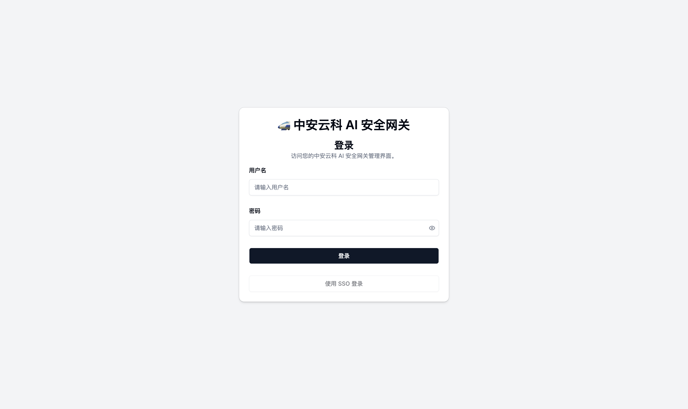

登录页字段说明：

| 字段 | 含义 | 是否必填 |
|---|---|---|
| 用户名 | 管理员为你分配的登录账号，通常是邮箱地址 | 是 |
| 密码 | 你的登录密码，首次使用由邀请链接自行设置 | 是 |

填好后点击 `登录`

页面右上角的 `使用 SSO 登录` 用于企业统一身份认证，仅在管理员开启 SSO 后可用，未开启时点击会提示不可用，直接忽略即可

连续多次输错密码不会自动锁定账号，但会记录到审计日志。忘记密码请联系管理员，由管理员在「内部用户」页面生成重置密码链接

### 1.2 首页与导航结构

登录后默认进入虚拟密钥页面。左侧导航按功能分为五组：

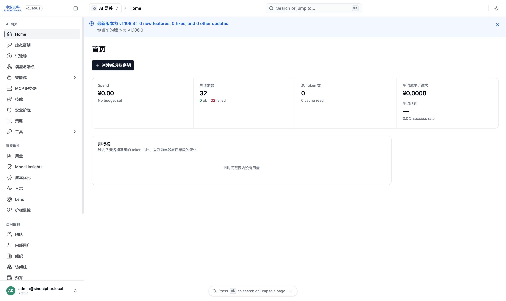

| 分组 | 包含菜单 | 用途 |
|---|---|---|
| AI 网关 | Home、虚拟密钥、试验场、模型与端点、智能体、MCP 服务器、技能、安全护栏、策略、工具 | 网关的核心配置与调用能力 |
| 可观测性 | 用量、Model Insights、成本优化、日志、Lens、护栏监控 | 查看消费、请求与护栏效果 |
| 访问控制 | 团队、内部用户、组织、访问组、预算 | 人员与资源授权 |
| 开发者工具 | API 参考、AI Hub、缓存、实验性功能 | 接口文档与辅助工具 |
| 设置 | 设置 | 授权信息等系统级配置 |

导航顶部有搜索入口，支持 `⌘K` 或 `Ctrl+K` 快速跳转页面或搜索密钥

右上角显示当前登录账号与角色，鼠标悬停可查看账号信息与退出登录

### 1.3 列表页通用操作

各功能列表页的操作方式一致，先统一说明：

| 控件 | 作用 |
|---|---|
| 搜索框 | 按名称、别名或 ID 过滤列表，不同页面支持的搜索字段不同，占位提示会写明 |
| 列 | 勾选需要显示的表格列，隐藏不关心的字段，设置仅对当前浏览器生效 |
| 筛选 | 打开筛选面板，按多个条件组合过滤 |
| 每页行数 | 控制单页显示条数，可选 25、50 等 |
| 分页 | 列表底部显示当前页与总页数，可翻页 |

表格右侧的 `操作` 列通常是一个图标按钮，点开后是本行的操作菜单，例如编辑、删除、复制 ID

---

## 二、AI 网关

### 2.1 模型端点管理

#### 2.1.1 进入模型与端点页面

左侧菜单 `AI 网关` 分组下点击 **模型与端点**，地址为 http://192.168.7.112:4000/ui/models-and-endpoints/

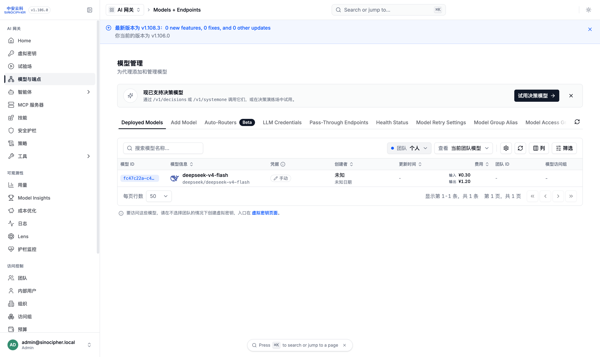

页面标题为「模型管理」，说明文字为「为代理添加和管理模型」，并提示已支持决策模型，可通过 `/v1/decisions` 或 `/v1/systemone` 调用

页面顶部有十个标签页：

| 标签页 | 作用 |
|---|---|
| Deployed Models | 已部署模型列表，日常查看与维护模型的主入口 |
| Add Model | 新增模型部署的表单 |
| Auto-Routers Beta | 自动路由配置，按规则把请求分发到不同模型 |
| LLM Credentials | 集中管理上游提供商的 API Key 等凭据，供多个模型复用 |
| Pass-Through Endpoints | 透传端点，把请求原样转发到上游 |
| Health Status | 各模型部署的健康状态与最近检查结果 |
| Model Retry Settings | 模型级重试次数与超时设置 |
| Model Group Alias | 模型组别名，给一组模型起一个对外名称 |
| Model Access Group Budgets Beta | 模型访问组预算，控制某个访问组的消费上限 |
| Price Data Reload | 重新加载价格数据，模型价格变动后手动刷新 |

已部署模型的表格字段：

| 字段 | 含义 |
|---|---|
| 模型 ID | 该条部署的唯一标识，系统自动生成 |
| 模型信息 | 模型名称、上游提供商、上下文长度等 |
| 凭据 | 该部署使用的上游凭据 |
| 创建者 | 创建该部署的账号 |
| 更新时间 | 最近一次修改时间 |
| 费用 | 该部署的输入、输出单价 |
| 团队 ID | 若模型属于某个团队则显示团队 ID |
| 模型访问组 | 该模型所属的访问组 |
| 操作 | 编辑、删除、测试等 |

#### 2.1.2 添加模型

切换到 `Add Model` 标签页填写新增模型表单

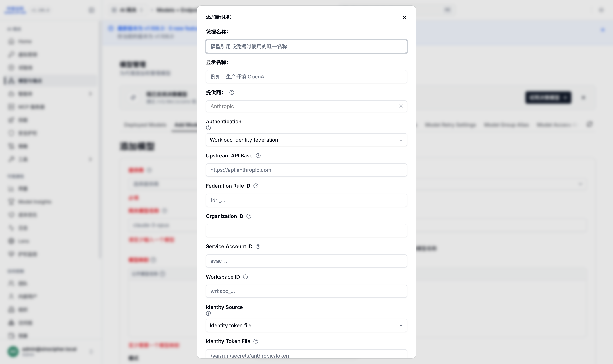

表单字段逐一说明：

**基础信息**

| 字段 | 含义 | 是否必填 |
|---|---|---|
| 提供商 | 上游模型服务商，如 deepseek、openai、anthropic。下拉选择，选择后决定后续可用字段与默认地址 | 是 |
| 网关模型名称 | 中安云科 AI 安全网关将发送给 LLM API 的模型名称。这里填上游真实模型名，例如 `deepseek/deepseek-v4-flash` | 是 |
| 模式 | 该部署支持的能力类型，用于健康检查与端点匹配，可选聊天、补全、嵌入等。普通对话模型保持默认聊天即可 | 否 |

**模型映射**

「模型映射」用于把对外的公开模型名称映射到上面填写的网关模型名称，至少需要一条映射

| 字段 | 含义 |
|---|---|
| 公开模型名称 | 业务方在请求体 `model` 字段里实际填写的名字，可自定义，例如 `deepseek-v4-flash` |
| 网关模型名称 | 该公开名称实际路由到的上游模型，通常与基础信息里的网关模型名称一致 |

一个公开名称可以对应一个上游模型，多个部署共用同一个公开名称时会自动做负载均衡

**凭据**

表单说明为「选择已有凭据或在下方输入新的提供商凭据」，两种方式二选一

| 字段 | 含义 |
|---|---|
| 已有凭据 | 从 LLM Credentials 里已保存的凭据中选择，适合多个模型共用同一 Key 的场景 |
| Upstream API Base | 上游接口地址。留空时使用提供商默认地址，例如 deepseek 默认 `https://api.deepseek.com/beta`；使用第三方中转时才需要填写 |
| API Key | 上游提供商的密钥，通常以 `sk-` 开头 |

**工作负载身份联合**

`使用工作负载身份联合` 是开关。说明为「工作负载身份联合会保存为凭证，然后附加到此模型」。仅在对接支持联合身份认证的云厂商时需要开启，普通 DeepSeek 调用保持关闭

**附加模型信息设置**

| 字段 | 含义 |
|---|---|
| 团队自带密钥模型 | 开启后表示该模型由团队自行提供密钥，费用不计入网关统一账单 |
| 模型访问组 | 把该模型归入访问组，便于按组批量授权给团队或密钥 |

**高级设置**

展开后可配置以下内容：

| 字段 | 含义 |
|---|---|
| 自定义定价 | 覆盖内置价目表，手工设置输入、输出、缓存读取单价。渠道价格与官方不一致时必须填写，否则消费统计与预算扣减会有偏差 |
| 附加知识库（RAG） | 选择要附加的向量存储，对该模型的请求会自动使用这些向量存储做检索增强。需先在工具下的向量存储中创建 |
| 护栏 | 给该模型挂载护栏，例如压缩护栏。可从已创建的护栏中选择 |
| 标签 | 给模型打标签，用于计费归属与筛选 |
| 在透传路由中使用 | 是否允许通过透传端点调用该模型 |
| 缓存控制注入点 | 设置提示词缓存标记注入的位置，用于开启上游缓存 |
| 中安云科 AI 安全网关参数 | 以 JSON 形式传入额外的调用参数，对应底层 `litellm.completion()` 支持的字段 |

表单底部有两个按钮：`测试连接` 用于在保存前验证凭据与地址是否可用，`添加模型` 用于保存

建议先点 `测试连接`，确认返回成功后再保存，避免配错后影响线上调用

### 2.2 压缩护栏管理

压缩护栏负责在请求到达模型之前压缩提示词，从而减少输入 Token 费用。它由两个地方共同构成：护栏本身的定义在「安全护栏」页面，压缩服务的地址与启用范围在「成本优化」页面

#### 2.2.1 查看护栏库

左侧菜单 `AI 网关` 分组下点击 **安全护栏**，地址为 http://192.168.7.112:4000/ui/guardrails/

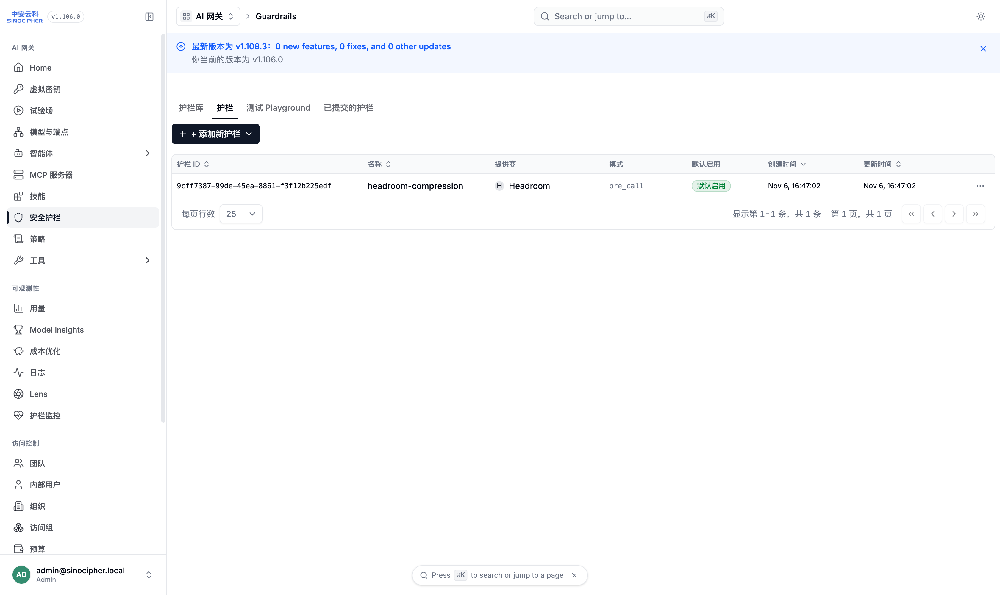

页面顶部有两个标签页：`护栏库` 与 `测试 Playground`。`测试 Playground` 用于在不影响线上请求的情况下试跑护栏效果

「已提交的护栏」表格字段：

| 字段 | 含义 |
|---|---|
| 护栏 ID | 护栏唯一标识，系统生成 |
| 名称 | 护栏名称，例如 `headroom-compression` |
| 提供商 | 护栏的实现提供方，压缩护栏为 `Headroom` |
| 模式 | 触发时机，`pre_call` 表示在调用模型前执行 |
| 默认启用 | 是否对所有请求默认生效 |
| 创建时间 | 创建时间 |
| 更新时间 | 最近修改时间 |
| 操作 | 编辑、测试、删除 |

#### 2.2.2 新增护栏

点击右上角 `+ 添加新护栏`，弹出两个选项

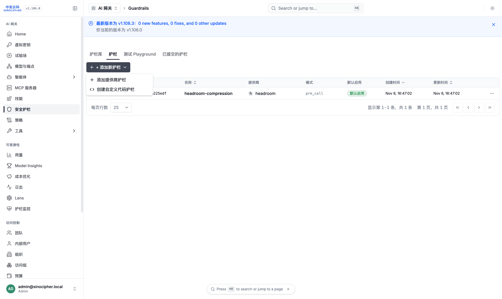

| 选项 | 用途 |
|---|---|
| 添加提供商护栏 | 使用内置提供商实现的护栏，压缩护栏选这一项 |
| 创建自定义代码护栏 | 自行编写代码实现护栏逻辑，需要开发能力 |

选择 `添加提供商护栏` 后进入两步式表单

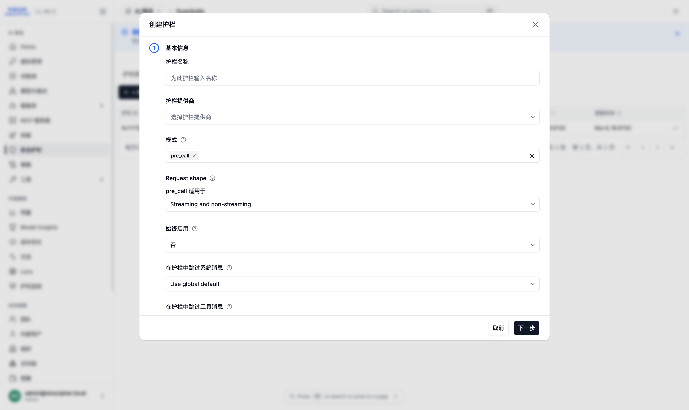

第一步「基本信息」字段说明：

| 字段 | 含义 | 是否必填 |
|---|---|---|
| 护栏名称 | 护栏的显示名称，同一网关内建议唯一，例如 `headroom-compression` | 是 |
| 护栏提供商 | 护栏实现方，压缩场景选择 `Headroom` | 是 |
| 模式 | 触发时机。`pre_call` 表示在请求发给模型之前执行，压缩护栏必须选这一项 | 是 |
| Request shape | 说明 `pre_call` 模式适用的请求类型，显示为同时适用于流式与非流式请求，只读 | 否 |
| 始终启用 | 是否让所有请求都强制经过该护栏。设为否时由模型或密钥单独挂载 | 否 |
| 在护栏中跳过系统消息 | 是否在压缩时保留系统消息不压缩。`Use global default` 表示沿用全局配置 | 否 |
| 在护栏中跳过工具消息 | 是否在压缩时保留工具调用消息不压缩。`Use global default` 表示沿用全局配置 | 否 |

点击 `下一步` 进入第二步「提供商配置」，填写该提供商所需的连接参数。表单底部为 `取消` 与 `下一步`，确认后保存

#### 2.2.3 配置 Headroom 压缩服务

护栏创建后，压缩服务的地址与启用范围在成本优化页面配置。进入 `可观测性` 分组下的 **成本优化**，切换到 `提示词压缩` 标签页

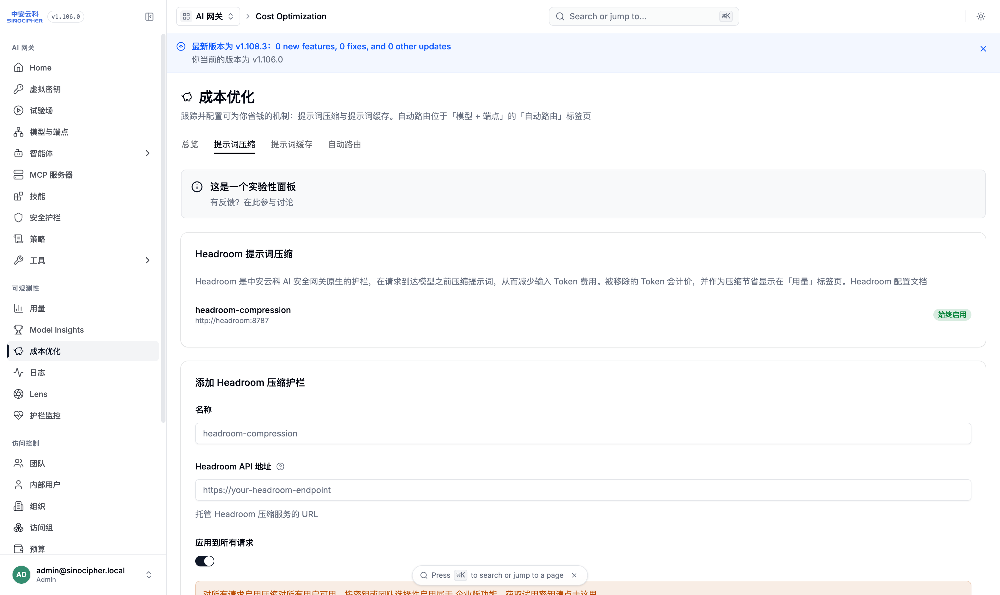

页面说明为：Headroom 是中安云科 AI 安全网关原生的护栏，在请求到达模型之前压缩提示词，从而减少输入 Token 费用。被移除的 Token 会计价，并作为压缩节省显示在「用量」标签页

配置字段：

| 字段 | 含义 | 是否必填 |
|---|---|---|
| 名称 | 该压缩配置的名称，与护栏库中的护栏名称对应 | 是 |
| Headroom API 地址 | 托管 Headroom 压缩服务的 URL，当前部署为 `http://headroom:8787`，容器内网地址，不要随意修改 | 是 |
| 应用到所有请求 | 是否让全部请求都经过压缩护栏 | 否 |

列表下方展示已生效的压缩配置，例如 `headroom-compression` 指向 `http://headroom:8787` 且标注「始终启用」

点击 `添加 Headroom 压缩护栏` 可新增配置。修改后建议先在 `测试 Playground` 里试跑，确认压缩没有破坏业务提示词再全局启用

### 2.3 虚拟密钥管理

#### 2.3.1 查看密钥列表

左侧菜单 `AI 网关` 分组下点击 **虚拟密钥**，地址为 http://192.168.7.112:4000/ui/api-keys/

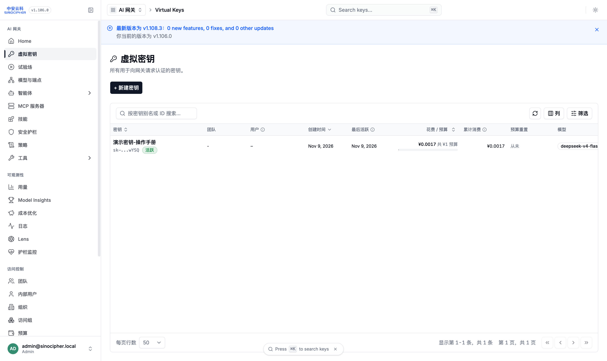

表格字段：

| 字段 | 含义 |
|---|---|
| 密钥 | 密钥别名与打码后的 Key 片段，以及是否活跃 |
| 团队 | 该密钥归属的团队 |
| 用户 | 该密钥归属的用户 |
| 创建时间 | 创建时间 |
| 最后活跃 | 最近一次被使用的时间，从未使用显示为「从不」 |
| 花费 / 预算 | 已消费金额与预算上限 |
| 累计消费 | 历史累计消费 |
| 预算重置 | 预算重置周期，未设置显示「不重置」 |
| 模型 | 该密钥允许访问的模型范围，全开时显示「所有代理模型」 |

搜索框支持按密钥别名或 ID 搜索

#### 2.3.2 新建密钥

点击右上角 `+ 新建密钥` 打开表单

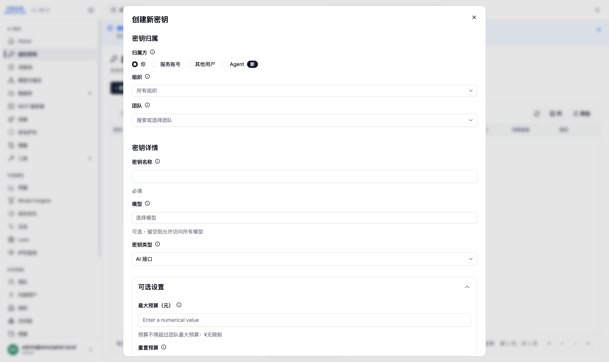

表单分多个区域，必填项与常用项在前，高级项在后

**密钥归属**

| 字段 | 含义 | 是否必填 |
|---|---|---|
| 归属方 | 密钥归属对象，可选 `你`、`服务账号`、`其他用户`、`Agent`。给业务系统用一般选「你」或「服务账号」 | 是 |
| 组织 | 密钥归属的组织，用于组织级统计与授权 | 否 |
| 团队 | 密钥归属的团队。归属团队后，密钥的预算、限流、模型范围受团队设置约束 | 否 |

**密钥详情**

| 字段 | 含义 | 是否必填 |
|---|---|---|
| 密钥名称 | 密钥别名，用于识别用途。建议格式为「业务名 + 用途」，例如「订单系统-key1」 | 是 |
| 模型 | 该密钥允许访问的模型。留空表示允许访问全部模型。只允许访问部分模型时必须在此选择 | 否 |
| 密钥类型 | 密钥用途类型，默认 `AI 接口`。若用于非模型接口可改选其他类型 | 是 |

**预算设置**

| 字段 | 含义 |
|---|---|
| 最大预算（元） | 该密钥的消费上限，单位人民币。不能超过所属团队的团队最大预算，页面上会提示当前团队上限 |
| 重置预算 | 预算的重置周期，例如每天、每月。未设置表示预算不重置 |
| 预算窗口 | 按时间窗叠加预算限制，用于更细粒度的成本控制，点击 `添加预算窗口` 添加 |
| 单模型预算 | 针对单个模型设置独立预算，属于高级功能。未开通时显示为 Premium 提示 |
| 预算回退 | 当某个模型超出其单模型预算时，把请求自动改派到备用模型，点击 `添加预算备用模型` 配置 |

**限流设置**

| 字段 | 含义 |
|---|---|
| 每分钟 Token 限制（TPM） | 该密钥每分钟可消耗的 Token 上限，不能超过团队 TPM 限制 |
| TPM 速率限制类型 | TPM 的计量方式，可选滑动窗口或固定窗口等 |
| 每分钟请求限制（RPM） | 该密钥每分钟可发起的请求数上限 |
| RPM 速率限制类型 | RPM 的计量方式 |
| 按标签速率限制 | 按请求标签分别限流，适用于同一密钥下区分不同业务的场景 |
| 超出预算时限流 | 开启后预算耗尽时不直接拒绝，而是降低速率 |

**防护与缓存**

| 字段 | 含义 |
|---|---|
| 启用提示词缓存 | 对该密钥的请求启用上游提示词缓存，重复前缀可命中缓存降低费用 |
| 护栏 | 给该密钥挂载护栏，可从已有护栏选择或输入新护栏名称 |
| 禁用全局护栏 | 让该密钥绕过全局启用的护栏，一般用于特殊业务规避压缩等处理 |

**授权范围**

| 字段 | 含义 |
|---|---|
| 策略 | 按密钥绑定访问策略，属于高级功能，未开通时显示升级提示 |
| 提示词 | 按密钥绑定提示词模板，属于高级功能 |
| 访问组 | 将该密钥分配给指定访问组，从而继承该组的模型访问范围 |
| 允许的透传路由 | 限制该密钥可调用的透传端点 |
| 允许的向量存储 | 限制该密钥可访问的向量存储 |
| 元数据 | 自定义键值对，随请求记录到日志，便于统计归属 |
| 标签 | 请求标签，用于成本分摊与筛选 |

**高级设置区域**

表单下方还有若干折叠区：MCP 设置、Agent 设置、技能设置、日志设置、路由设置、模型别名、密钥生命周期、高级设置。这些属于进阶配置，日常创建密钥保持默认即可，需要时再展开

填写完成后点击 `创建密钥`

#### 2.3.3 保存密钥

创建成功后弹出保存窗口

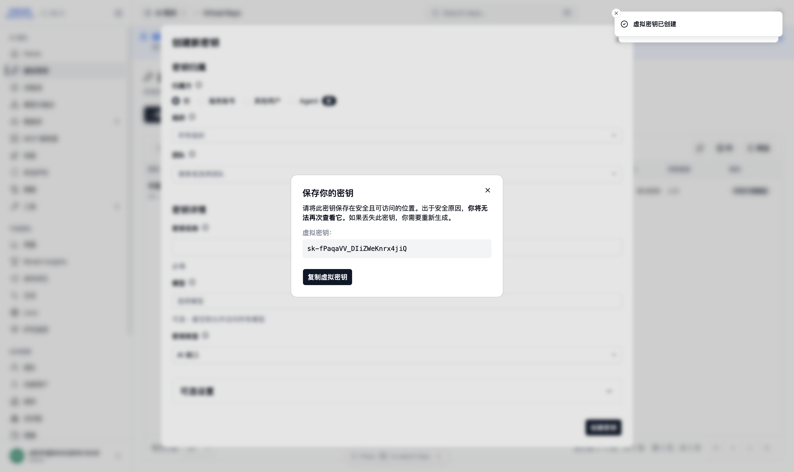

窗口提示为：请将此密钥保存在安全且可访问的位置。出于安全原因，你将无法再次查看它。如果丢失此密钥，你需要重新生成

| 元素 | 说明 |
|---|---|
| 虚拟密钥 | 完整密钥，以 `sk-` 开头 |
| 复制虚拟密钥 | 一键复制到剪贴板 |
| 关闭 | 关闭窗口 |

密钥只在此刻完整展示一次，关闭后无法再次查看。请立即点击 `复制虚拟密钥` 并保存到密码管理器等安全位置

若丢失密钥，只能在列表中删除旧密钥后重新创建

---

## 三、访问控制

### 3.1 团队管理

#### 3.1.1 查看团队列表

左侧菜单 `访问控制` 分组下点击 **团队**，地址为 http://192.168.7.112:4000/ui/teams/

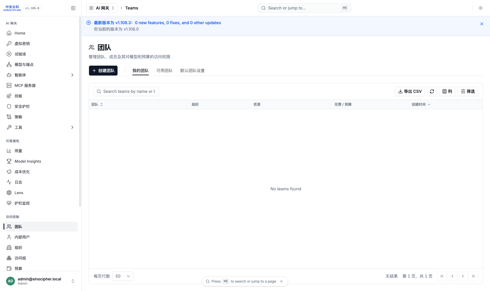

页面顶部有三个标签页：

| 标签页 | 作用 |
|---|---|
| 我的团队 | 你是成员的团队 |
| 可用团队 | 你可以加入的团队 |
| 默认团队设置 | 新团队创建时使用的默认配置模板 |

表格字段：

| 字段 | 含义 |
|---|---|
| 团队 | 团队名称与 ID |
| 组织 | 团队所属组织 |
| 资源 | 团队下的成员、密钥等资源数量 |
| 花费 / 预算 | 团队已消费金额与预算上限 |
| 创建时间 | 创建时间 |
| 操作 | 编辑、删除、成员管理等 |

右上角 `导出 CSV` 可把团队列表导出为表格文件

#### 3.1.2 创建团队

点击右上角 `创建团队` 打开表单

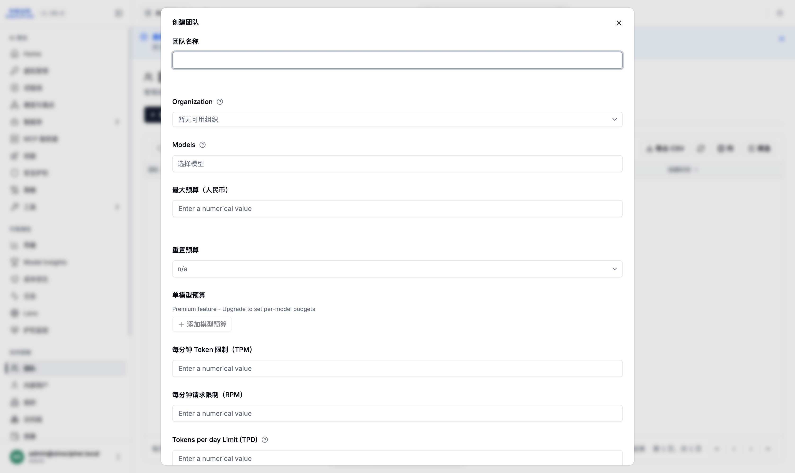

**基础字段**

| 字段 | 含义 | 是否必填 |
|---|---|---|
| 团队名称 | 团队显示名称，建议与组织架构一致，例如「研发中心」 | 是 |
| Organization | 团队所属组织，用于组织级汇总 | 否 |
| Models | 该团队可访问的模型范围，留空表示不限制 | 否 |

**预算与限流**

| 字段 | 含义 |
|---|---|
| 最大预算（人民币） | 团队整体消费上限，团队下所有密钥的消费合计不能超过该值 |
| 重置预算 | 团队预算的重置周期 |
| 单模型预算 | 按模型设置独立预算，属于高级功能，未开通显示 Premium 提示 |
| 添加模型预算 | 为指定模型单独设置预算上限 |
| 每分钟 Token 限制（TPM） | 团队整体每分钟 Token 上限，团队下密钥的 TPM 不能超过该值 |
| 每分钟请求限制（RPM） | 团队整体每分钟请求数上限 |
| Tokens day Limit (TPD) | 团队每日 Token 用量上限，用于控制日常总额 |

**元数据**

| 字段 | 含义 |
|---|---|
| 元数据 | 自定义键值对。页面说明为「值按文本保存。类型化值请输入 JSON，例如 3、true 或 {"region": "us"}」，点击 `添加键值对` 添加 |

**附加设置**

展开后包含以下字段：

| 字段 | 含义 |
|---|---|
| 团队 ID | 要创建的团队 ID，不填则系统自动生成。需要与外部系统对齐 ID 时才手工指定 |
| Team Member Budget (CNY) | 团队成员默认预算上限，单位人民币 |
| Team Member Key Duration | 团队成员创建的密钥默认有效期，例如 `1d`、`1mo` |
| Team Member RPM Limit | 团队成员默认的每分钟请求上限 |
| Team Member TPM Limit | 团队成员默认的每分钟 Token 上限 |
| 密钥管理器设置 | 对接外部密钥管理器，属于高级功能 |
| Guardrails | 为该团队挂载护栏，团队下密钥默认继承 |
| Global Guardrails | 是否禁用全局护栏，属于高级功能 |
| Policies | 为该团队绑定访问策略 |
| Access Groups | 把团队加入访问组，继承该组的模型访问范围 |
| Allowed Vector Stores | 该团队可访问的向量存储，留空表示不限制 |
| Allowed Pass Through Routes | 该团队可使用的透传路由 |

**资源授权**

| 字段 | 含义 |
|---|---|
| Allowed MCP Servers | 该团队可访问的 MCP 服务器或访问组 |
| Allowed Agents | 该团队可访问的 Agent 或访问组 |
| Allowed Search Tools | 限制该团队下的密钥可以调用的已配置搜索工具 |
| Allowed Skills | 该团队下的密钥在 Claude Code 市场中可以看到的私有技能 |

**日志与路由**

| 字段 | 含义 |
|---|---|
| 日志设置 | 选择该团队的日志投递目标，例如 langfuse-logging、datadog-logging。属于高级功能，需要先在系统设置中配好对应集成 |
| 负载均衡 | 同一模型组内多个部署的分发策略，如简单轮询、最低延迟 |
| 回退 | 主模型不可用时的备用模型列表 |
| 路由策略 | 更复杂的路由规则，例如按成本或延迟选择 |
| 启用标签过滤 | 是否按请求标签过滤可用部署 |
| 允许失败次数 | 连续失败多少次后把该部署标记为不可用 |
| 冷却时间 | 部署被标记不可用后保持冷却的时长 |
| 重试次数 | 请求失败后的重试次数 |
| 超时时间 | 单次请求超时时间 |
| 重试等待 | 两次重试之间的间隔 |
| 模型分组别名 | 为模型组设置别名，简化调用 |
| 模型别名 | 别名名称、目标模型、添加别名，用于给外部提供自定义模型名 |

填写完成后保存即创建团队

### 3.2 内部用户管理

#### 3.2.1 查看用户列表

左侧菜单 `访问控制` 分组下点击 **内部用户**，地址为 http://192.168.7.112:4000/ui/users/

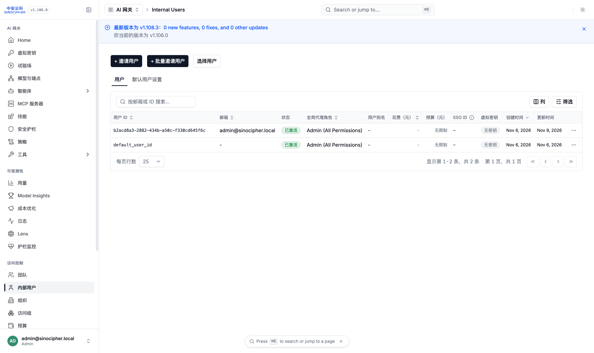

页面顶部有两个标签页：`用户` 与 `默认用户设置`，后者用于配置新用户的默认角色、默认预算等

表格字段：

| 字段 | 含义 |
|---|---|
| 用户 ID | 用户唯一标识，系统生成 |
| 邮箱 | 用户登录账号 |
| 状态 | 账号状态，如活跃、已停用 |
| 全局代理角色 | 用户的全局权限角色 |
| 用户别名 | 用户显示名称 |
| 花费（元） | 该用户累计消费，单位人民币 |
| 预算（元） | 该用户的预算上限 |
| SSO ID | 若通过单点登录接入，显示外部身份 ID |
| 虚拟密钥 | 该用户名下的密钥数量 |
| 创建时间 | 创建时间 |
| 更新时间 | 最近修改时间 |
| 操作 | 编辑、重置密码、复制用户 ID、删除用户等 |

#### 3.2.2 邀请用户

点击右上角 `+ 邀请用户` 打开表单

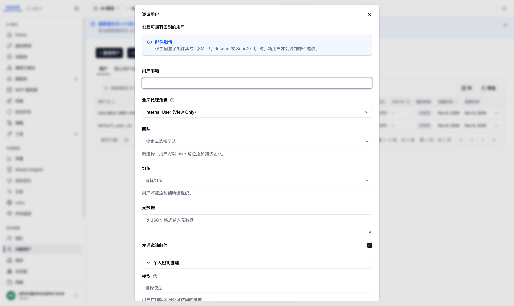

表单说明为「创建可拥有密钥的用户」，顶部提示「邮件邀请」，并说明仅当配置了邮件集成（SMTP、Resend 或 SendGrid）时，新用户才会收到邮件邀请

字段说明：

| 字段 | 含义 | 是否必填 |
|---|---|---|
| 用户邮箱 | 新用户的邮箱，同时作为登录账号 | 是 |
| 全局代理角色 | 用户权限范围。可选 `Internal User (View Only)` 只读、`Internal User (Create/Delete/View)` 可管理自己的密钥、`Admin (View Only)` 只读管理员、`Admin (All Permissions)` 完全管理员。默认值为只读 | 是 |
| 团队 | 若选择，用户将以 `user` 角色添加到该团队，从而继承团队的预算与模型范围 | 否 |
| 组织 | 用户将被添加到所选组织 | 否 |
| 元数据 | 自定义键值对，用于记录部门、工号等信息 | 否 |
| 发送邀请邮件 | 是否发送邮件通知。未配置邮件服务时此开关无效，需要手动复制邀请链接 | 否 |

折叠区「个人密钥创建」展开后包含：

| 字段 | 含义 |
|---|---|
| 模型 | 用户在团队范围外可访问的模型。即使不属于任何团队，也能通过该设置获得模型访问权限 |

**这一项容易被忽略。** 如果用户不属于任何团队，且这里也没有配置模型，用户创建密钥后调用会返回 403，提示没有模型访问权限

填写后点击 `邀请用户`

#### 3.2.3 复制邀请链接

创建成功后弹出邀请链接窗口，显示 User ID 与 Invitation Link。点击复制按钮把链接发给用户

链接格式为：

```
http://192.168.7.112:4000/ui/onboarding?invitation_id=xxxxxxxx-xxxx-xxxx-xxxx-xxxxxxxxxxxx
```

用户打开链接后设置密码即完成注册

邀请链接有效期 7 天。链接失效后，在用户列表的操作菜单里选择重置密码，生成新的重置链接发给用户

#### 3.2.4 用户操作菜单

用户列表每行的操作菜单包含：

| 菜单项 | 作用 |
|---|---|
| 编辑用户 | 修改角色、预算、模型范围等 |
| 重置密码 | 生成重置密码链接 |
| 复制用户 ID | 复制用户 ID 到剪贴板 |
| 删除用户 | 删除该用户，其名下密钥需另行处理 |

使用 `+ 批量邀请用户` 可以一次导入多个用户，适合新团队批量开通

---

## 四、可观测性

### 4.1 用量

#### 4.1.1 用量总览

左侧菜单 `可观测性` 分组下点击 **用量**，地址为 http://192.168.7.112:4000/ui/usage/

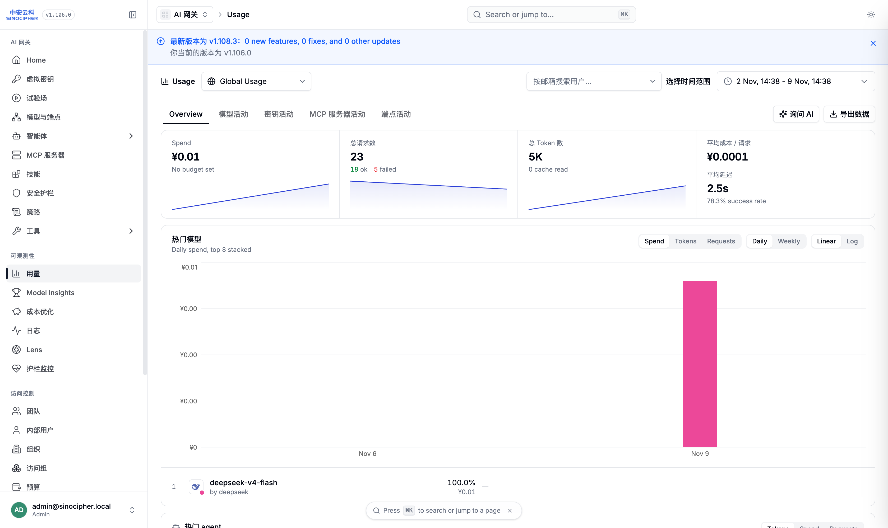

页面顶部控制区：

| 控件 | 作用 |
|---|---|
| Global Usage | 在全局用量与个人用量之间切换。管理员可查看全局，普通用户默认只看自己 |
| 选择时间范围 | 统计区间，默认最近 7 天 |
| 询问 AI | 用自然语言提问用量，例如「哪个模型最花钱」 |
| 导出数据 | 导出用量报表 |

页面标签页：

| 标签页 | 统计维度 |
|---|---|
| Overview | 总体指标与趋势，默认页 |
| 模型活动 | 按模型统计调用次数、Token 与费用 |
| 密钥活动 | 按密钥统计消费与占比 |
| MCP 服务器活动 | 按 MCP 服务器统计调用 |
| 端点活动 | 按网关端点统计请求分布 |

Overview 页指标卡片：

| 指标 | 含义 |
|---|---|
| Spend | 所选区间总消费，单位人民币 |
| No budget set | 未设置预算上限时显示，设置了则显示预算使用进度 |
| 总请求数 | 区间内请求总数，并区分成功与失败数 |
| 总 Token 数 | 区间内消耗的 Token 总量，并显示缓存读取量 |
| 平均成本 / 请求 | 总消费除以总请求数 |
| 平均延迟 | 请求平均耗时 |
| success rate | 请求成功率，等于成功数除以总数 |

页面下方依次是「热门模型」「热门 agent」「按提供商统计花费」「热门虚拟密钥」四个图表，可在 Spend、Tokens、Requests 之间切换统计口径，也可切换 Daily、Weekly、Linear、Log 等呈现方式

#### 4.1.2 按模型与密钥查看用量

切换到 `模型活动` 标签页

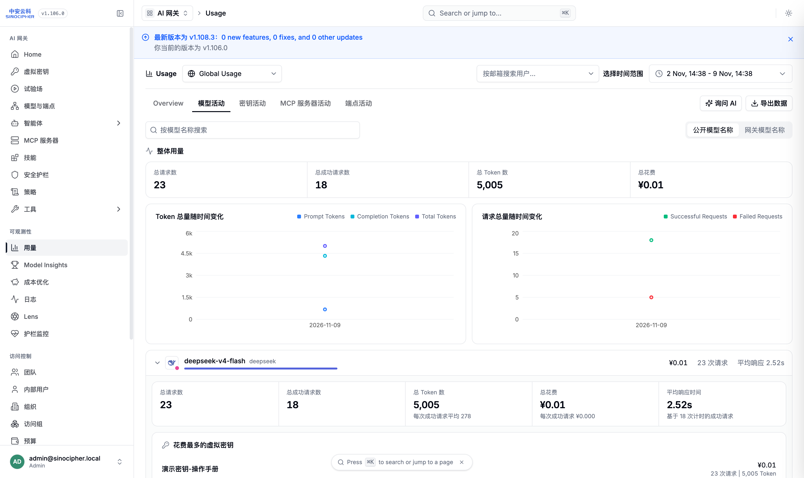

该页按模型列出调用次数、Token 用量、消费金额与占比，可用于判断哪个模型成本最高

切换到 `密钥活动` 标签页

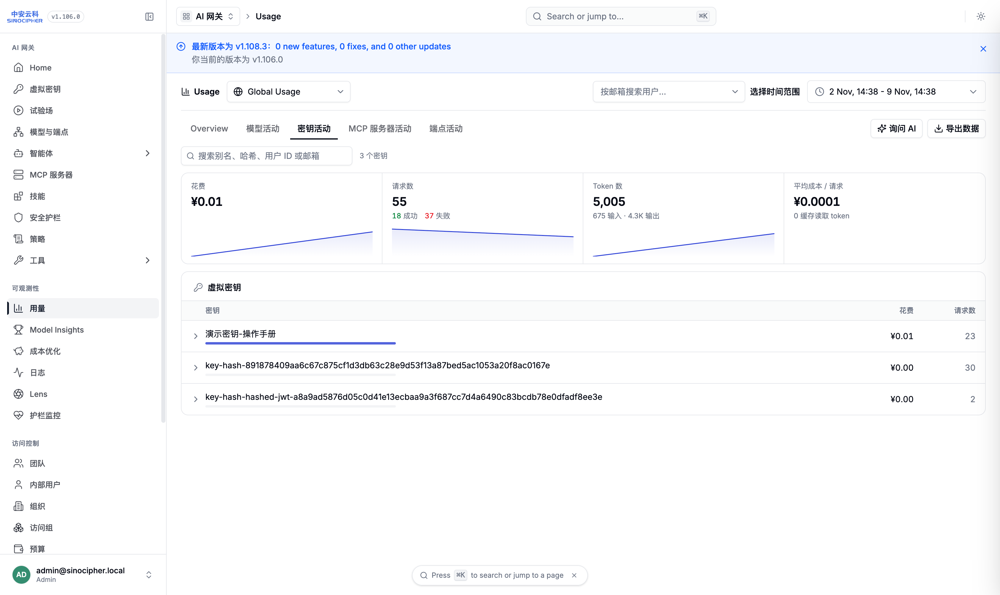

该页按密钥列出消费金额与占比，配合密钥别名可以定位到具体业务系统

#### 4.1.3 导出用量数据

点击 `导出数据`，弹出导出窗口

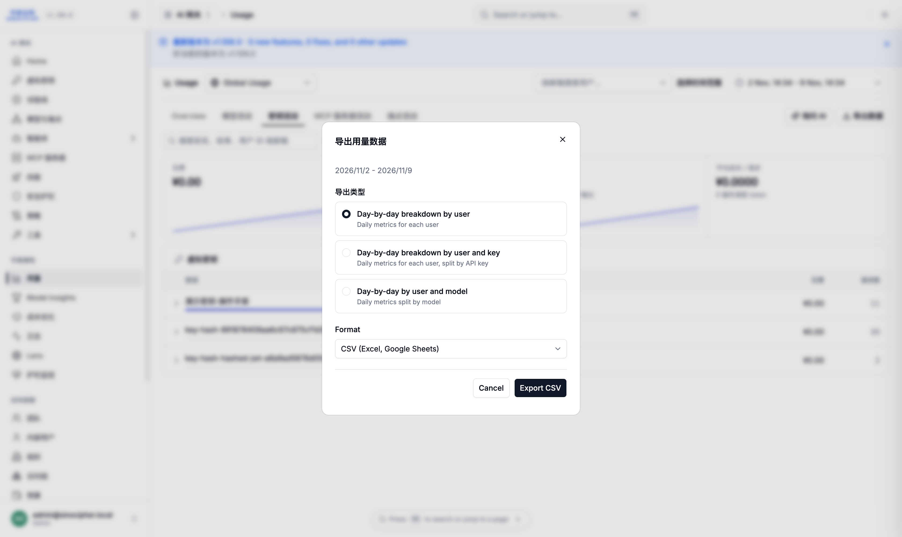

| 字段 | 含义 |
|---|---|
| 导出类型 | 报表粒度，可选择按用户、按用户与密钥、按用户与模型做每日拆分 |
| Format | 导出文件格式，当前支持 CSV，可用 Excel 或 Google Sheets 打开 |

窗口顶部显示本次导出的日期范围，即页面上选择的时间区间。确认后点击导出按钮下载文件

### 4.2 日志

#### 4.2.1 查看请求日志

左侧菜单 `可观测性` 分组下点击 **日志**，地址为 http://192.168.7.112:4000/ui/logs/

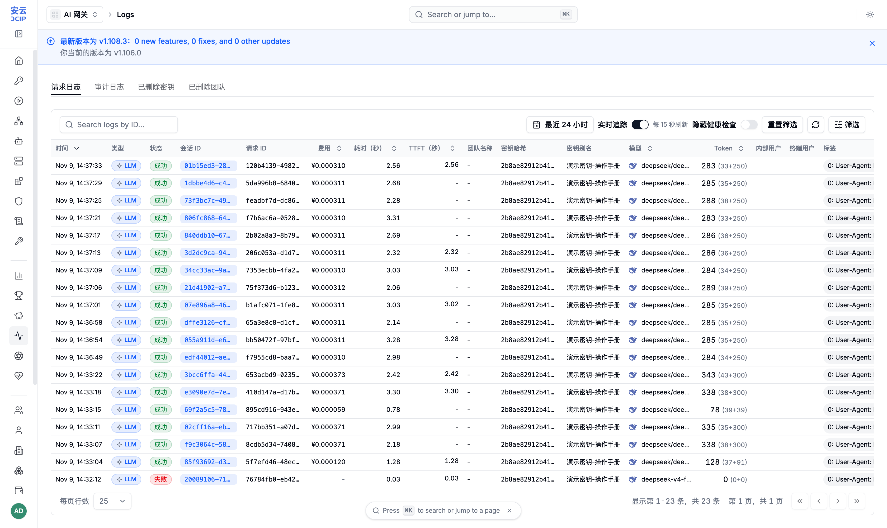

页面顶部有四个标签页：

| 标签页 | 内容 |
|---|---|
| 请求日志 | 模型请求的详细记录，日常排查主入口 |
| 审计日志 | 管理操作记录，例如创建密钥、修改团队 |
| 已删除密钥 | 已删除密钥的历史记录 |
| 已删除团队 | 已删除团队的历史记录 |

请求日志工具栏：

| 控件 | 作用 |
|---|---|
| 最近 24 小时 | 时间范围选择，默认最近 24 小时 |
| 实时追踪 | 自动滚动并持续加载最新请求 |
| 每 15 秒刷新 | 开关自动刷新 |
| 隐藏健康检查 | 过滤掉网关自身的健康检查请求，避免干扰 |
| 重置筛选 | 清空全部筛选条件 |
| 筛选 | 打开筛选面板 |

日志列表字段：

| 字段 | 含义 |
|---|---|
| 时间 | 请求发生时间 |
| 类型 | 请求类型，例如 LLM 调用、健康检查 |
| 状态 | 成功或失败 |
| 会话 ID | 同一会话的多次请求共享该 ID，便于串联多轮对话 |
| 请求 ID | 单次请求的唯一标识 |
| 费用 | 该次请求的消费，单位人民币 |
| 耗时（秒） | 从发出请求到收到完整响应的总耗时 |
| TTFT（秒） | 首 Token 时间，即从发出请求到收到第一个 Token 的时间，流式场景的关键指标 |
| 团队名称 | 发起请求的团队 |
| 密钥哈希 | 所用密钥的哈希值，用于定位具体密钥而不暴露明文 |
| 密钥别名 | 所用密钥的别名 |
| 模型 | 实际调用的模型名 |
| Token | 该次请求消耗的 Token 总数 |
| 内部用户 | 发起请求的网关用户 |
| 终端用户 | 请求携带的终端用户标识 |
| 标签 | 请求携带的标签 |

#### 4.2.2 筛选日志

点击 `筛选` 打开筛选面板

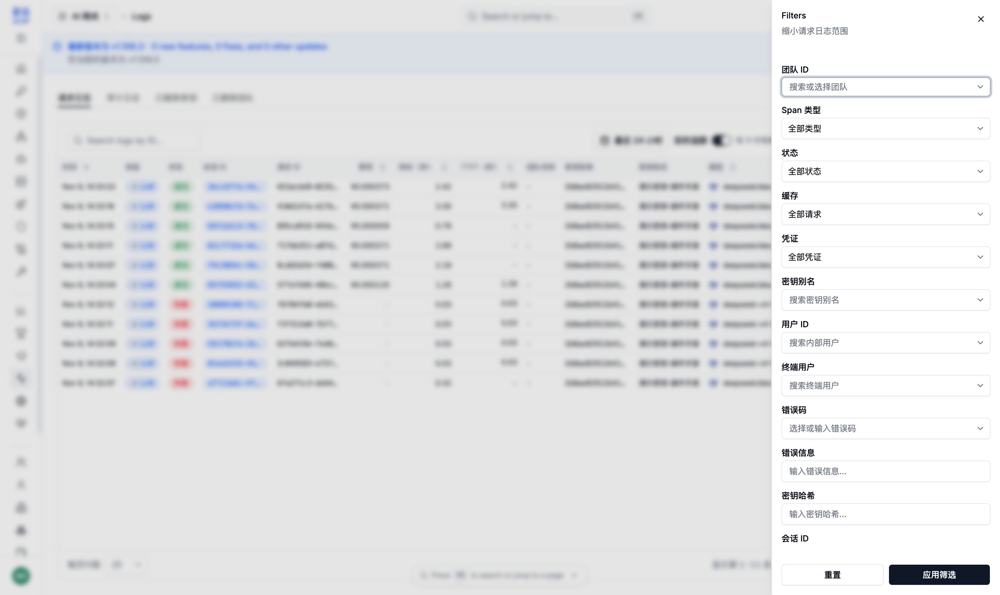

| 筛选项 | 含义 |
|---|---|
| 团队 ID | 按团队过滤 |
| Span 类型 | 按调用链路中的 Span 类型过滤，默认全部类型 |
| 状态 | 按成功或失败过滤，默认全部状态 |
| 缓存 | 按是否命中提示词缓存过滤，默认全部请求 |
| 凭证 | 按使用的上游凭据过滤，默认全部凭证 |
| 密钥别名 | 按密钥别名过滤 |
| 用户 ID | 按内部用户过滤 |
| 终端用户 | 按终端用户标识过滤 |
| 错误码 | 按 HTTP 错误码过滤 |
| 错误信息 | 按错误文本模糊匹配 |
| 密钥哈希 | 按密钥哈希过滤 |
| 会话 ID | 按会话过滤，用于查看完整多轮对话 |
| 模型 | 按模型名过滤 |
| 公共模型 / 搜索工具 | 按对外模型名或搜索工具过滤 |

填好后点 `应用筛选` 生效，点 `重置` 清空条件，点 `关闭` 收起面板

#### 4.2.3 查看请求详情

点击任意一条日志，从右侧滑出详情抽屉

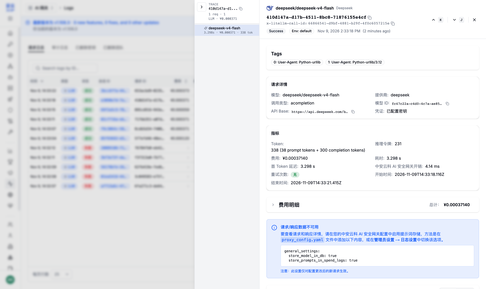

详情分几块：

| 区域 | 内容 |
|---|---|
| 顶部 TRACE | 请求 ID、模型、耗时、费用、Token 数、提供商、状态与时间，以及请求携带的 Tags，例如客户端 User-Agent、调用链 ID |
| 请求详情 | 模型、提供商、调用类型、模型 ID、API Base、凭证 |
| 指标 | Token（拆分为输入与输出）、推理令牌、费用、耗时、首 Token 延迟、网关上开销 |
| 费用明细 | 本次请求的成本构成，可核对输入、输出、缓存各部分计费 |
| 工具 | 本次请求提供给模型的工具，以及实际调用了哪些 |
| 请求与响应 | 在 Pretty 与 JSON 两种视图间切换，查看完整消息与响应原文 |

排查计费异常时，重点看「费用明细」与「指标」里的缓存读取量，缓存命中的输入按更低单价计费

### 4.3 成本优化

左侧菜单 `可观测性` 分组下点击 **成本优化**，地址为 http://192.168.7.112:4000/ui/cost-optimization/

页面说明为：跟踪并配置可为你省钱的机制，即提示词压缩与提示词缓存，自动路由位于「模型 + 端点」的「自动路由」标签页

页面顶部标注「这是一个实验性面板」，并说明花费按 UTC 日期分桶，因此统计日期与本地时间可能相差 8 小时

四个标签页：`总览`、`提示词压缩`、`提示词缓存`、`自动路由`

#### 4.3.1 总览

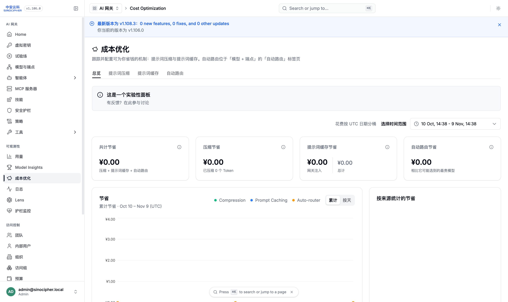

| 字段 | 含义 |
|---|---|
| 共计节省 | 所选区间内通过压缩、缓存、路由总共节省的金额 |
| 压缩节省 | 提示词压缩带来的节省 |
| 已压缩 | 经过压缩的请求数 |
| 提示词缓存节省 | 命中提示词缓存带来的节省 |
| 网关注入 | 网关主动注入缓存标记带来的节省 |
| 自动路由节省 | 自动路由选择更便宜模型带来的节省 |

可以按时间范围查看趋势，用于评估各项优化措施的实际收益

#### 4.3.2 提示词压缩


该页配置 Headroom 压缩护栏，字段说明见 2.2.3

被压缩移除的 Token 仍会计价，节省金额体现在「用量」页的压缩节省中

#### 4.3.3 提示词缓存

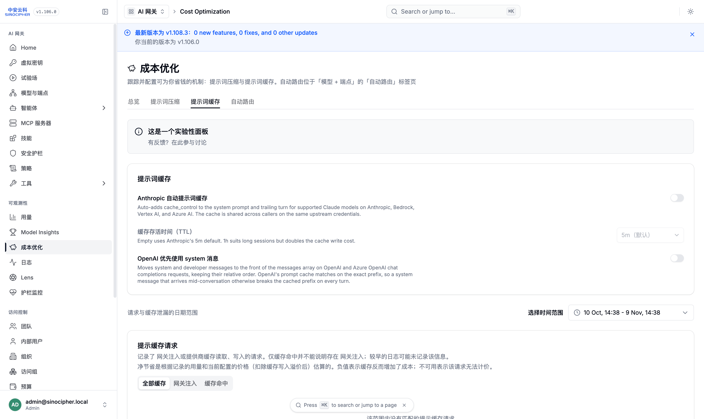

该页配置提示词缓存策略

| 字段 | 含义 |
|---|---|
| Anthropic 自动提示词缓存 | 自动为 Anthropic、Bedrock、Vertex AI、Azure AI 上的 Claude 模型添加 `cache_control` 系统提示与轮次，缓存会在使用同一上游凭据的调用方之间共享 |
| 缓存存活时间（TTL） | 缓存保留时长。留空使用 Anthropic 默认的 5 分钟；1 小时适合长会话，但缓存写入成本翻倍 |
| OpenAI 优先使用 system 消息 | 在 OpenAI 与 Azure OpenAI 请求中把 system 与 developer 消息前移并保持顺序。OpenAI 的提示词缓存按精确前缀匹配，中途插入消息会破坏已缓存前缀 |
| 请求与缓存泄漏的日期范围 | 选择统计区间 |
| 提示缓存请求 | 列出了网关注入或提供商缓存读取、写入的请求。说明中指出，仅缓存命中并不能说明存在网关注入，较早的日志可能未记录该信息 |
| 净节省 | 根据记录的用量与当前配置价格估算，已扣除缓存写入溢价。负值表示缓存反而增加了成本，不可用表示该请求无法计价 |

#### 4.3.4 自动路由

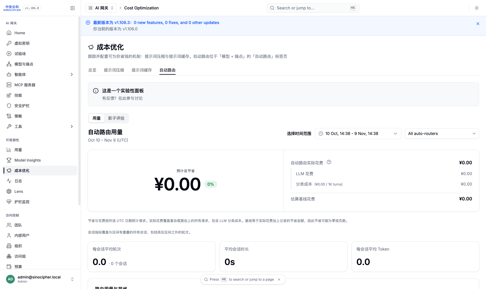

自动路由按规则把请求分发到不同模型，例如简单问题走便宜模型、复杂问题走强模型。该页展示自动路由规则的命中情况与节省效果，规则的创建在「模型与端点」的 `Auto-Routers` 标签页完成

---

## 五、设置

### 5.1 授权管理

左侧菜单最下方 `设置` 分组下点击 **设置**，进入授权信息页面，地址为 http://192.168.7.112:4000/ui/product-license/

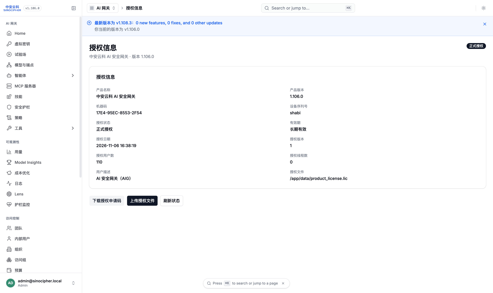

页面顶部显示产品名称与当前版本，右侧徽标显示授权状态，例如「正式授权」

授权信息字段：

| 字段 | 含义 |
|---|---|
| 产品名称 | 被授权的产品名，例如「中安云科 AI 安全网关」 |
| 产品版本 | 当前运行版本，例如 1.106.0 |
| 机器码 | 本机唯一机器码，申请授权时提供给授权方 |
| 设备序列号 | 设备序列号，用于标识硬件 |
| 授权状态 | 当前授权类型，如正式授权、试用授权、未授权 |
| 有效期 | 授权到期时间，长期授权显示为长期有效 |
| 授权日期 | 授权生效时间 |
| 授权版本 | 授权文件的版本号 |
| 授权用户数 | 允许接入的用户数量上限 |
| 授权线程数 | 允许的并发线程数上限，0 表示不限制 |
| 用户描述 | 授权对应的客户或项目描述 |
| 授权文件 | 授权文件在服务器上的路径，例如 `/app/data/product_license.lic` |

页面底部三个操作：

| 操作 | 作用 |
|---|---|
| 下载授权申请码 | 生成申请码文件，提交给授权方换取正式授权文件 |
| 上传授权文件 | 上传授权方下发的 `.lic` 文件，上传后立即生效 |
| 刷新状态 | 重新读取授权文件，用于排查授权未生效的问题 |

**更换授权或扩容的流程：** 先点 `下载授权申请码` 拿到本机申请码，发给授权方；收到 `.lic` 文件后点 `上传授权文件` 并选择文件；上传完成点 `刷新状态` 确认授权状态、有效期与用户数已更新

**升级版本后需要重新确认授权。** 产品版本变化可能导致原授权失效，升级后应回到本页检查授权状态，必要时重新上传授权文件

---

## 六、附录

### 6.1 常见问题

| 现象 | 原因 | 处理 |
|---|---|---|
| 登录提示用户名或密码错误 | 账号或密码不正确 | 核对账号；忘记密码联系管理员生成重置链接 |
| 调用返回 401 | 密钥错误、已删除或已过期 | 核对密钥是否完整复制；在虚拟密钥页面重建 |
| 调用返回 403，提示没有模型访问权限 | 用户没有配置模型范围，且不属于任何有权模型访问的团队 | 联系管理员在用户编辑页或个人密钥创建的模型字段中补配 |
| 调用返回 400，提示没有可用部署 | 请求的模型名不存在或未部署 | 核对公开模型名称；联系管理员确认该模型已部署 |
| 调用返回 429 | 触发 TPM 或 RPM 限流，或所有部署进入冷却 | 降低请求频率；若长期不足联系管理员调整限额 |
| 日志页看不到刚才的请求 | 时间范围默认最近 24 小时，或请求被隐藏健康检查过滤 | 调整时间范围；关闭隐藏健康检查 |
| 花费与上游账单对不上 | 自定义定价未配置，或缓存计费口径差异 | 检查模型的「自定义定价」；在日志详情中核对费用明细 |
| 授权状态显示异常 | 授权文件缺失或版本升级后授权失效 | 在授权信息页点刷新状态，必要时重新上传授权文件 |

### 6.2 术语说明

| 术语 | 含义 |
|---|---|
| 虚拟密钥 | 网关签发的调用凭证，以 `sk-` 开头，用于业务系统调用模型 |
| 公开模型名称 | 业务方在请求里填写的模型名，由网关映射到实际上游模型 |
| 网关模型名称 | 网关发往上游 API 的真实模型名 |
| 部署 | 一个模型的一条上游接入配置，同一模型名可以有多个部署做负载均衡 |
| TPM / RPM | 每分钟 Token 数 / 每分钟请求数，用于限流 |
| TPD | 每日 Token 数上限 |
| 提示词缓存 | 上游对重复前缀的输入按更低单价计费，可显著降低成本 |
| 提示词压缩 | 在请求发给模型前移除冗余内容，减少输入 Token |
| 护栏 | 在请求或响应上执行的检查与处理逻辑，压缩护栏属于其中一种 |
| TTFT | 首 Token 时间，从发出请求到收到第一个 Token 的耗时 |
