# 中安云科 AI 安全网关 操作手册

本文档面向使用中安云科 AI 安全网关的业务用户，按操作步骤逐一说明各功能页面的使用方法、表单字段含义与注意事项

适用版本：v1.106.0

## 关于网关地址

本手册不写死具体地址，统一用 `<网关地址>` 表示你实际部署的访问地址，例如：

- `http://服务器IP:4000`
- `https://ai.example.com`

端口默认为 4000，部署时可通过环境变量 `LITELLM_PORT` 调整

管理后台的统一入口为：`<网关地址>/ui/`

本文截图取自 v1.106.0 界面，图中的密钥、团队、用户与请求数据均为演示数据，不代表任何具体部署

---

## 目录

- 一、登录与界面导览
- 二、AI 网关
  - 2.1 模型端点管理
  - 2.2 压缩护栏管理
  - 2.3 虚拟密钥管理
- 三、访问控制
  - 3.1 团队管理
  - 3.2 内部用户管理
- 四、可观测性
  - 4.1 用量
  - 4.2 日志
  - 4.3 成本优化
- 五、设置
  - 5.1 授权管理
- 六、附录

---

## 一、登录与界面导览

### 1.1 登录

**步骤一：打开管理后台**

在浏览器地址栏输入 `<网关地址>/ui/`，回车后进入登录页

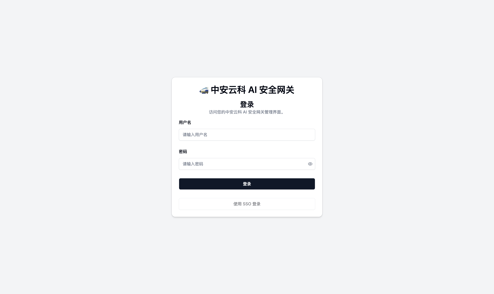

页面包含两个输入框：

| 字段 | 含义 | 是否必填 |
|---|---|---|
| 用户名 | 管理员为你分配的登录账号，通常是邮箱地址 | 是 |
| 密码 | 你的登录密码，首次使用由邀请链接自行设置 | 是 |

页面右上角的 `使用 SSO 登录` 用于企业统一身份认证，仅在管理员开启 SSO 后可用

**步骤二：输入用户名**

在用户名框中填写你的账号

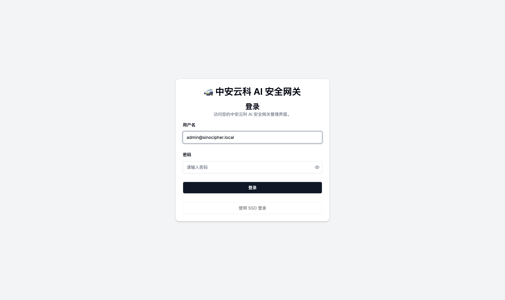

**步骤三：输入密码**

在密码框中填写密码，输入内容以圆点显示

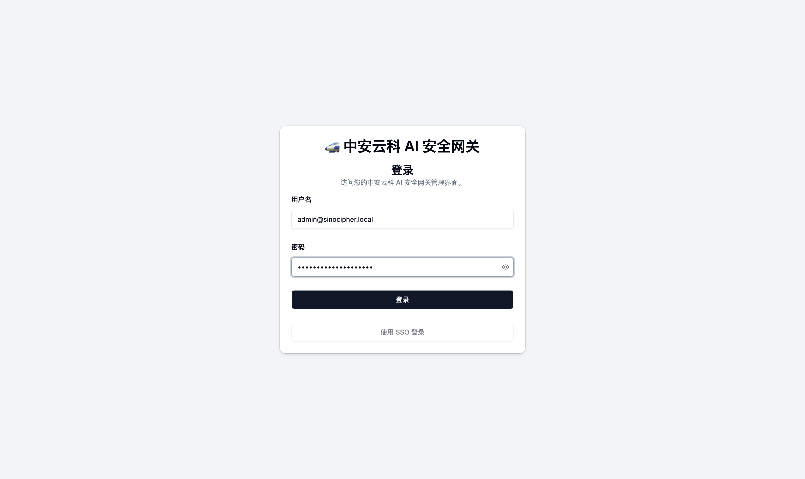

**步骤四：点击登录**

点击 `登录` 按钮，验证通过后进入管理后台首页

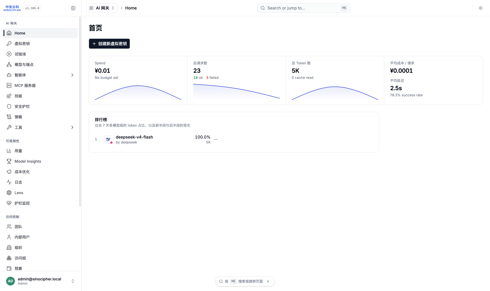

连续多次输错密码不会自动锁定账号，但会记录到审计日志。忘记密码请联系管理员在「内部用户」页面生成重置密码链接

### 1.2 界面结构

登录后界面分为四个区域：

| 区域 | 说明 |
|---|---|
| 顶部栏 | 左侧为搜索入口，支持快捷键 `Ctrl+K` 或 `⌘K` 快速跳转页面或搜索密钥；右侧为当前账号与角色 |
| 左侧导航 | 按 AI 网关、可观测性、访问控制、开发者工具、设置五组排列功能菜单 |
| 内容区 | 当前页面主体，列表、表单与图表都在这里 |
| 底部提示 | 部分页面底部有快捷键提示与分页信息 |

左侧导航分组与菜单：

| 分组 | 菜单 |
|---|---|
| AI 网关 | Home、虚拟密钥、试验场、模型与端点、智能体、MCP 服务器、技能、安全护栏、策略、工具 |
| 可观测性 | 用量、Model Insights、成本优化、日志、Lens、护栏监控 |
| 访问控制 | 团队、内部用户、组织、访问组、预算 |
| 开发者工具 | API 参考、AI Hub、缓存、实验性功能 |
| 设置 | 设置 |

### 1.3 列表页通用操作

各功能列表页的操作方式一致：

| 控件 | 作用 |
|---|---|
| 搜索框 | 按名称、别名或 ID 过滤，占位提示会写明支持的字段 |
| 列 | 勾选要显示的表格列，设置仅对当前浏览器生效 |
| 筛选 | 打开筛选面板，按多个条件组合过滤 |
| 每页行数 | 控制单页显示条数，可选 25、50 等 |
| 分页 | 列表底部显示当前页与总页数 |
| 操作 | 表格最右侧的图标按钮，点开是本行操作菜单，如编辑、删除、复制 ID |

---

## 二、AI 网关

### 2.1 模型端点管理

#### 2.1.1 进入模型与端点页面

左侧菜单 `AI 网关` 分组下点击 **模型与端点**，进入模型管理页面，地址为 `<网关地址>/ui/models-and-endpoints/`

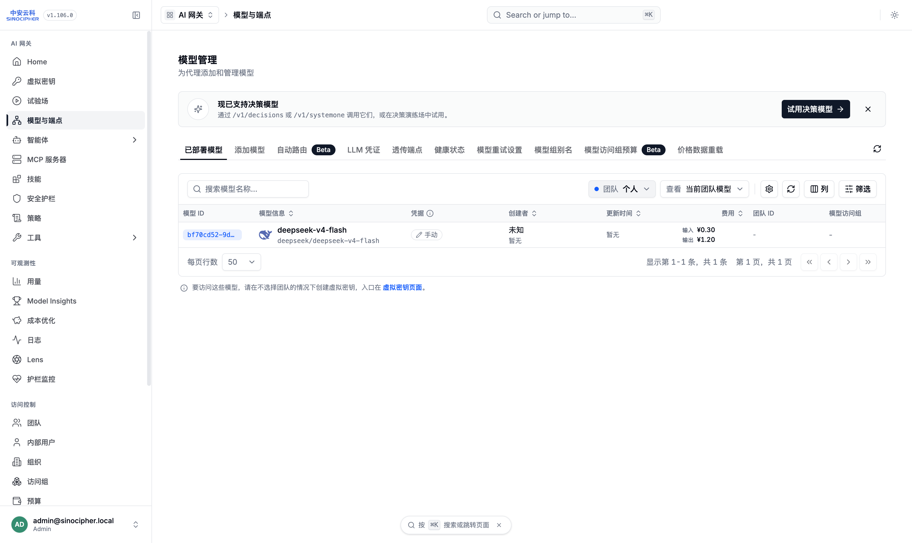

页面顶部有十个标签页：

| 标签页 | 作用 |
|---|---|
| 已部署模型 | 查看与维护已部署的模型，日常主入口 |
| 添加模型 | 新增模型部署 |
| 自动路由 Beta | 按规则把请求分发到不同模型 |
| LLM 凭证 | 集中管理上游提供商的密钥，供多个模型复用 |
| 透传端点 | 把请求原样转发到上游 |
| 健康状态 | 各部署的健康检查结果 |
| 模型重试设置 | 模型级重试次数与超时 |
| 模型组别名 | 给一组模型设置对外别名 |
| 模型访问组预算 Beta | 按访问组控制消费上限 |
| 价格数据重载 | 模型价格变动后手动刷新 |

「已部署模型」表格字段：

| 字段 | 含义 |
|---|---|
| 模型 ID | 该条部署的唯一标识，系统生成 |
| 模型信息 | 模型名称、上游提供商、上下文长度等 |
| 凭据 | 该部署使用的上游凭据 |
| 创建者 | 创建该部署的账号 |
| 更新时间 | 最近一次修改时间 |
| 费用 | 该部署的输入、输出单价 |
| 团队 ID | 若模型归属团队则显示团队 ID |
| 模型访问组 | 该模型所属的访问组 |
| 操作 | 编辑、删除、测试等 |

#### 2.1.2 添加模型：分步操作

**步骤一：切换到添加模型**

点击页面顶部的 `添加模型` 标签页

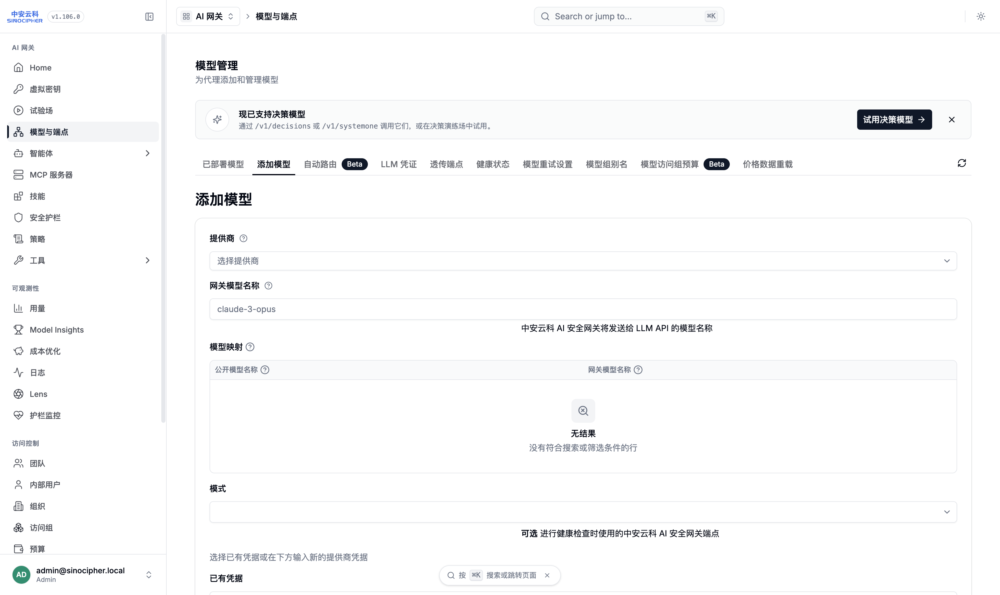

表单从上到下依次为：提供商、网关模型名称、模型映射、模式、凭据、附加模型信息设置、高级设置，底部为 `测试连接` 与 `添加模型`

**步骤二：选择提供商**

点击「提供商」下拉框，在弹出的列表中搜索并选择上游服务商，例如 Deepseek

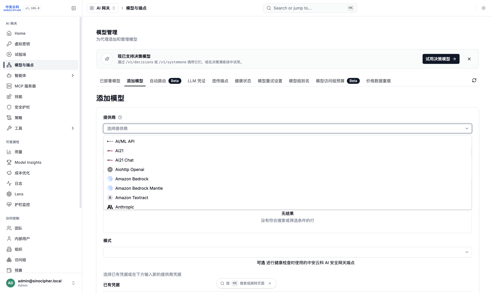

提供商决定后续可选的模型清单与默认接口地址。列表按字母排序，可直接输入关键字筛选

**步骤三：确认提供商**

选中后，下拉框显示已选提供商

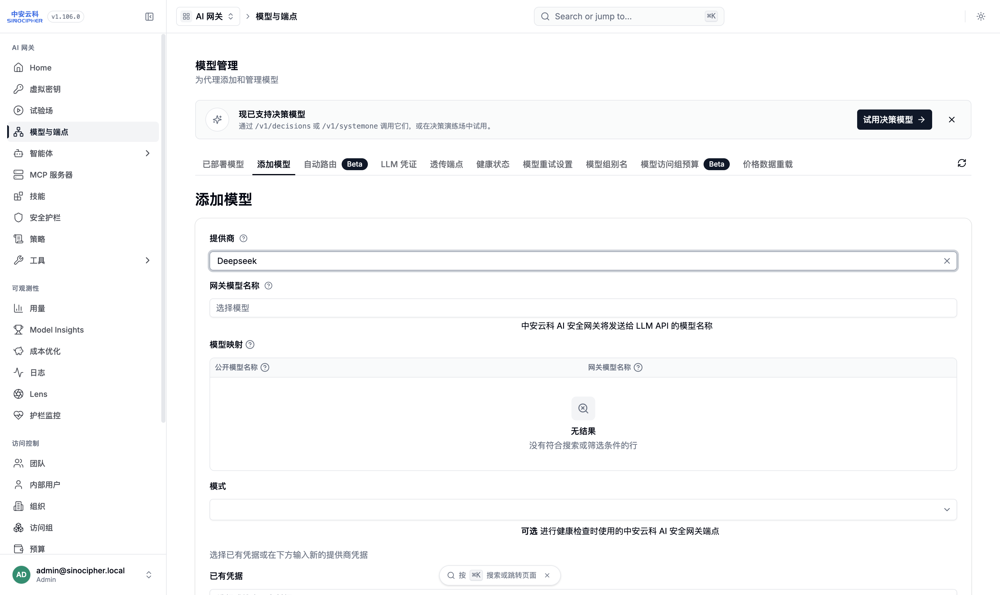

**步骤四：选择网关模型名称**

点击「网关模型名称」下拉框，列表包含三类选项：

- `自定义模型名称（在下方输入）`：手工填写上游模型名
- `所有 Deepseek 模型（通配）`：通配该提供商下的全部模型
- 具体模型名，如 `deepseek/deepseek-v4-flash`、`deepseek/deepseek-v4-pro`

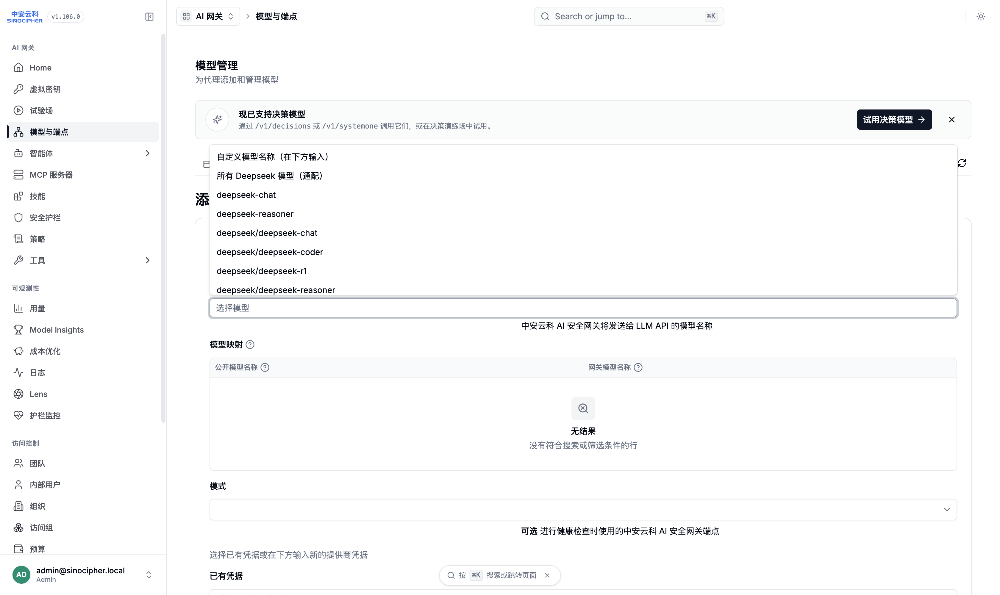

**步骤五：确认模型名称**

选中后，网关模型名称显示为所选模型

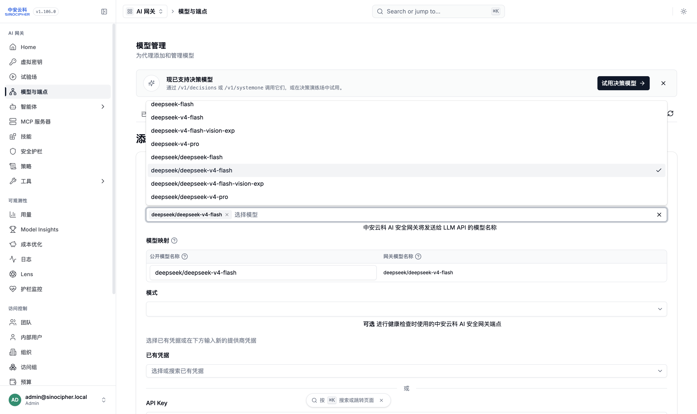

「网关模型名称」的含义是：中安云科 AI 安全网关发送给上游 LLM API 的真实模型名。这一项决定请求实际落到哪个上游模型

**步骤六：填写公开模型名称**

在「模型映射」区域填写公开模型名称

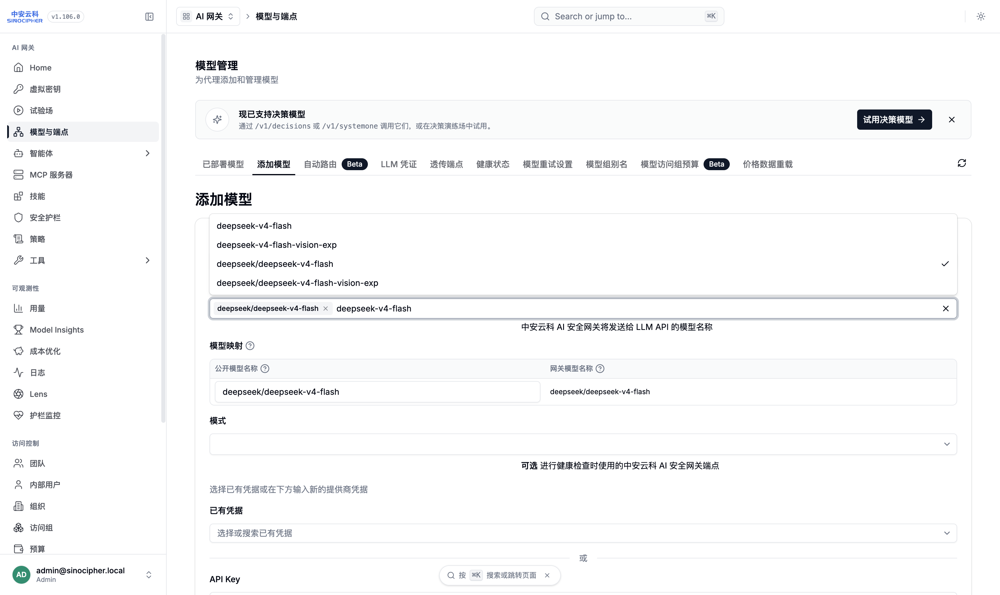

「模型映射」把对外的公开名称映射到上游模型名，字段说明：

| 字段 | 含义 |
|---|---|
| 公开模型名称 | 业务方在请求体 `model` 字段里填写的名字，可自定义，例如 `deepseek-v4-flash` |
| 网关模型名称 | 该公开名称实际路由到的上游模型，自动带入上一步选择的值 |

公开模型名称是业务侧感知到的名字，建议保持简洁稳定；后续更换上游模型时只改映射，业务代码不用动

**步骤七：填写 API Key**

在「凭据」区域填写上游提供商的密钥，输入内容以圆点显示

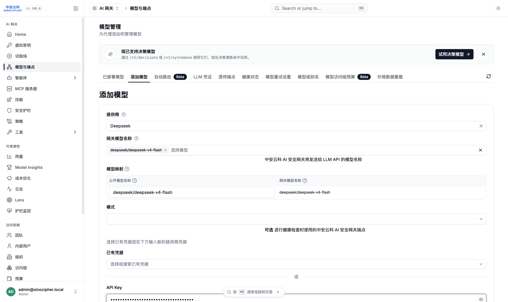

凭据区域字段说明：

| 字段 | 含义 |
|---|---|
| 已有凭据 | 从 LLM 凭证中选择已保存的凭据，适合多个模型共用同一密钥 |
| API Key | 直接填写上游密钥，通常以 `sk-` 开头 |

两种方式二选一：已有凭据优先，未选时使用下方填写的 API Key

**步骤八：展开高级设置**

点击 `高级设置` 展开进阶配置

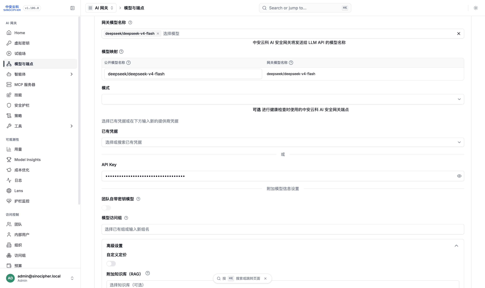

高级设置中的字段：

| 字段 | 含义 |
|---|---|
| 自定义定价 | 覆盖内置价目表，手工设置输入、输出、缓存读取单价。渠道价格与官方不一致时必须填写，否则消费统计与预算扣减会有偏差 |
| 附加知识库（RAG） | 选择要附加的向量存储，对该模型的请求会自动检索增强。需先在工具下的向量存储中创建 |
| 护栏 | 给该模型挂载护栏，例如压缩护栏 |
| 标签 | 给模型打标签，用于计费归属与筛选 |
| 在透传路由中使用 | 是否允许通过透传端点调用该模型 |
| 缓存控制注入点 | 设置提示词缓存标记的注入位置，用于开启上游缓存 |
| 中安云科 AI 安全网关参数 | 以 JSON 传入额外调用参数，对应底层 `litellm.completion()` 支持的字段 |

**步骤九：测试连接并保存**

先点击 `测试连接` 验证提供商、地址与密钥是否可用，确认成功后再点击 `添加模型` 保存

保存后模型出现在「已部署模型」列表中，可正常被密钥调用

### 2.2 压缩护栏管理

压缩护栏在请求到达模型之前压缩提示词，减少输入 Token 费用。护栏定义在「安全护栏」页面，压缩服务地址在「成本优化」页面

#### 2.2.1 进入安全护栏页面

左侧菜单 `AI 网关` 分组下点击 **安全护栏**，地址为 `<网关地址>/ui/guardrails/`

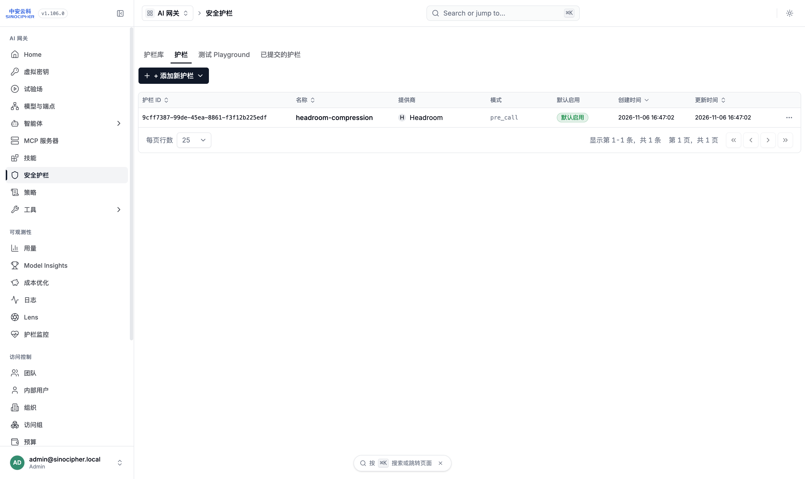

页面顶部有两个标签页：`护栏库` 与 `测试 Playground`。后者用于在不影响线上请求的情况下试跑护栏效果

「已提交的护栏」表格字段：

| 字段 | 含义 |
|---|---|
| 护栏 ID | 护栏唯一标识 |
| 名称 | 护栏名称，例如 `headroom-compression` |
| 提供商 | 护栏实现方，压缩护栏为 `Headroom` |
| 模式 | 触发时机，`pre_call` 表示调用模型前执行 |
| 默认启用 | 是否对所有请求默认生效 |
| 创建时间 | 创建时间 |
| 更新时间 | 最近修改时间 |
| 操作 | 编辑、测试、删除 |

#### 2.2.2 添加压缩护栏：分步操作

**步骤一：点击添加新护栏**

点击页面右上角 `+ 添加新护栏`

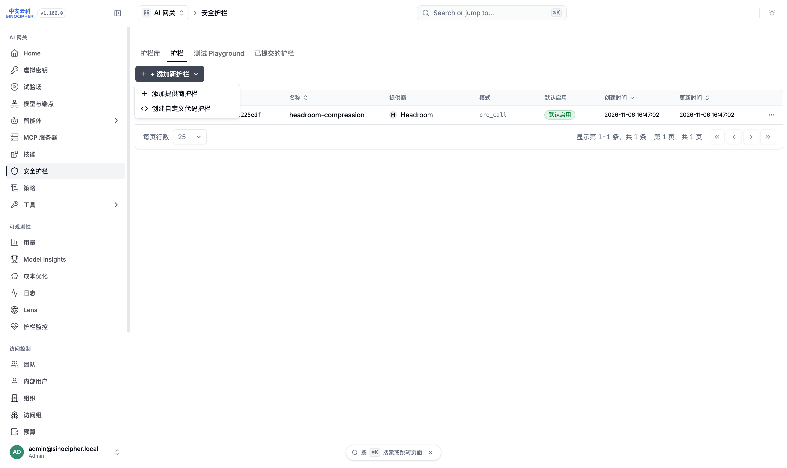

弹出两个选项：

| 选项 | 用途 |
|---|---|
| 添加提供商护栏 | 使用内置提供商实现的护栏，压缩护栏选这一项 |
| 创建自定义代码护栏 | 自行编写代码实现护栏，需要开发能力 |

**步骤二：选择添加提供商护栏**

点击 `添加提供商护栏`，进入两步式表单的第一步「基本信息」

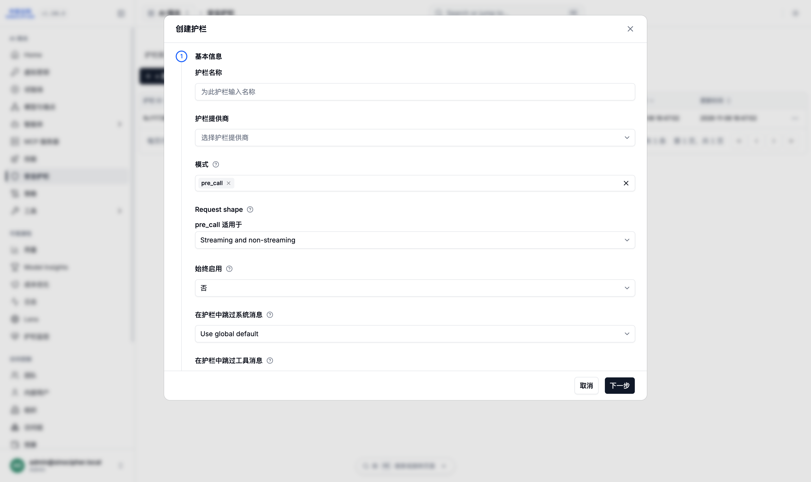

**步骤三：填写护栏名称**

在「护栏名称」中填写名称，建议与用途一致，例如 `headroom-compression`

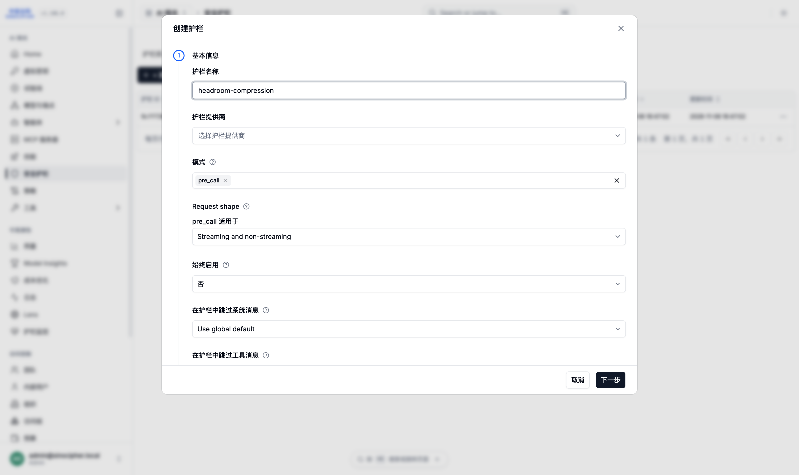

第一步「基本信息」字段说明：

| 字段 | 含义 | 是否必填 |
|---|---|---|
| 护栏名称 | 护栏显示名称，同一网关内建议唯一 | 是 |
| 护栏提供商 | 护栏实现方，压缩场景选 `Headroom` | 是 |
| 模式 | 触发时机，压缩护栏必须选 `pre_call`，即在请求发给模型前执行 | 是 |
| Request shape | 说明该模式适用的请求类型，只读 | 否 |
| 始终启用 | 是否让所有请求强制经过该护栏；设为否时由模型或密钥单独挂载 | 否 |
| 在护栏中跳过系统消息 | 压缩时是否保留系统消息不压缩，`Use global default` 表示沿用全局配置 | 否 |
| 在护栏中跳过工具消息 | 压缩时是否保留工具调用消息不压缩 | 否 |

**步骤四：选择护栏提供商**

点击「护栏提供商」下拉框，在列表中搜索并选择 Headroom

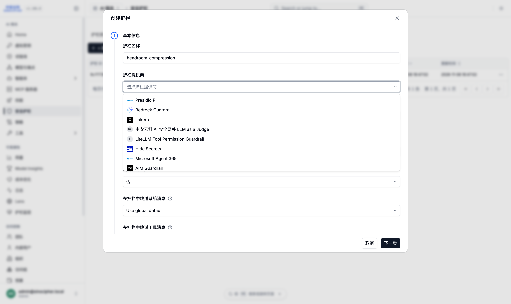

选择后，表单会按该提供商展示对应的配置项

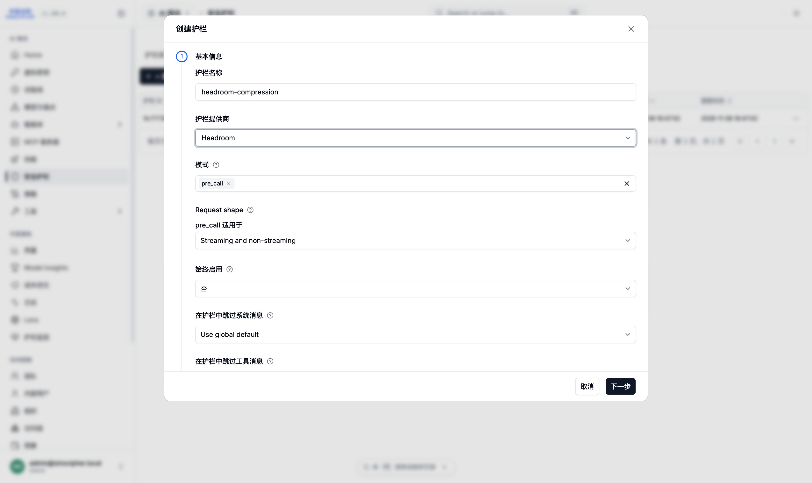

**步骤五：进入提供商配置**

点击 `下一步`，进入第二步「提供商配置」

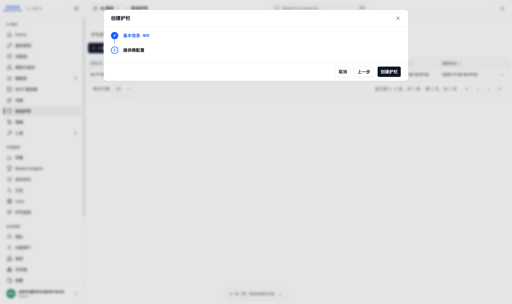

这一步填写该提供商所需的连接参数，不同提供商字段不同。确认无误后点击 `创建护栏` 完成创建，也可以点 `上一步` 返回修改基本信息

#### 2.2.3 配置压缩服务地址

护栏创建后，压缩服务的连接地址在成本优化页面配置

进入 `可观测性` 分组下的 **成本优化**，切换到 `提示词压缩` 标签页

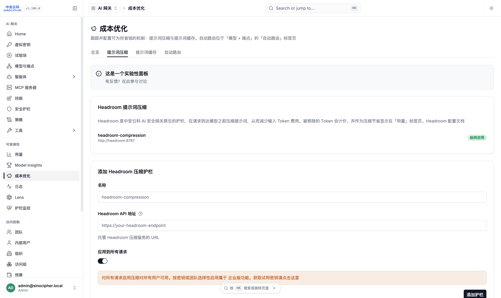

页面说明为：Headroom 是中安云科 AI 安全网关原生的护栏，在请求到达模型之前压缩提示词，从而减少输入 Token 费用。被移除的 Token 会计价，并作为压缩节省显示在「用量」标签页

配置字段：

| 字段 | 含义 | 是否必填 |
|---|---|---|
| 名称 | 该压缩配置的名称，与护栏库中的护栏名称对应 | 是 |
| Headroom API 地址 | 托管 Headroom 压缩服务的 URL，使用部署时的压缩服务地址，不要随意修改 | 是 |
| 应用到所有请求 | 是否让全部请求都经过压缩护栏 | 否 |

列表下方展示已生效的配置。修改后建议先在 `测试 Playground` 试跑，确认压缩没有破坏业务提示词再全局启用

### 2.3 虚拟密钥管理

#### 2.3.1 进入虚拟密钥页面

左侧菜单 `AI 网关` 分组下点击 **虚拟密钥**，地址为 `<网关地址>/ui/api-keys/`

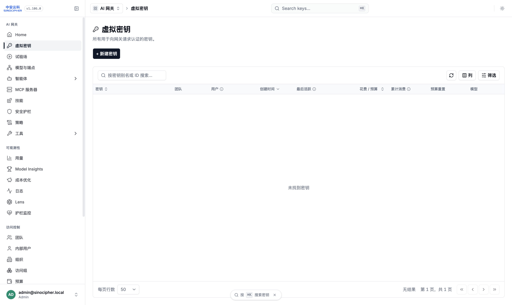

表格字段：

| 字段 | 含义 |
|---|---|
| 密钥 | 密钥别名、打码后的 Key 片段与是否活跃 |
| 团队 | 该密钥归属的团队 |
| 用户 | 该密钥归属的用户 |
| 创建时间 | 创建时间 |
| 最后活跃 | 最近一次使用时间，从未使用显示为「从不」 |
| 花费 / 预算 | 已消费金额与预算上限 |
| 累计消费 | 历史累计消费 |
| 预算重置 | 预算重置周期，未设置显示「不重置」 |
| 模型 | 允许访问的模型范围，全开时显示「所有代理模型」 |

#### 2.3.2 新建密钥：分步操作

**步骤一：点击新建密钥**

点击页面右上角 `+ 新建密钥`

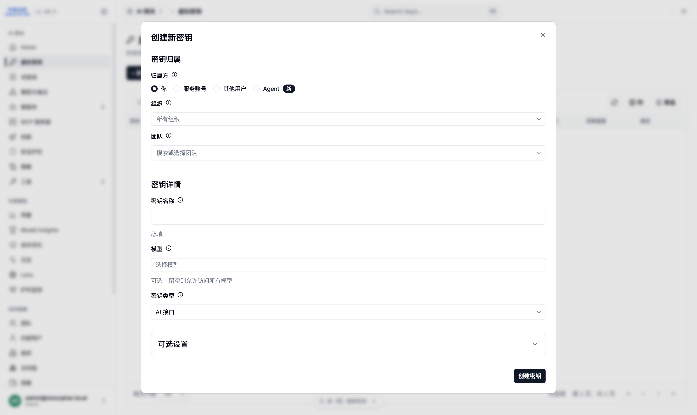

表单分为密钥归属、密钥详情、可选设置、高级设置几个区域

**步骤二：填写密钥名称**

在「密钥名称」中填写别名，建议体现业务与用途，例如「订单系统-key1」


「密钥归属」区域字段：

| 字段 | 含义 | 是否必填 |
|---|---|---|
| 归属方 | 密钥归属对象，可选 `你`、`服务账号`、`其他用户`、`Agent`。业务系统接入一般选「你」或「服务账号」 | 是 |
| 组织 | 密钥归属的组织，用于组织级统计与授权 | 否 |
| 团队 | 密钥归属的团队。归属团队后，预算、限流、模型范围受团队设置约束 | 否 |

「密钥详情」区域字段：

| 字段 | 含义 | 是否必填 |
|---|---|---|
| 密钥名称 | 密钥别名，用于识别用途 | 是 |
| 模型 | 允许访问的模型，留空表示允许访问全部模型 | 否 |
| 密钥类型 | 密钥用途类型，默认 `AI 接口` | 是 |

**步骤三：选择可访问模型**

点击「模型」下拉框，选择允许该密钥访问的模型，或选择「所有代理模型」放开全部


**步骤四：设置预算**

在「最大预算（元）」中填写消费上限


预算相关字段：

| 字段 | 含义 |
|---|---|
| 最大预算（元） | 该密钥消费上限，单位人民币，不能超过所属团队的团队最大预算 |
| 重置预算 | 预算重置周期，如每天、每月；未设置表示不重置 |
| 预算窗口 | 按时间窗叠加预算限制，点击 `添加预算窗口` 添加 |
| 单模型预算 | 针对单个模型设置独立预算，属于高级功能 |
| 预算回退 | 模型超出单模型预算时改派到备用模型，点击 `添加预算备用模型` 配置 |

**步骤五：设置限流**

填写 TPM 与 RPM 等限流参数

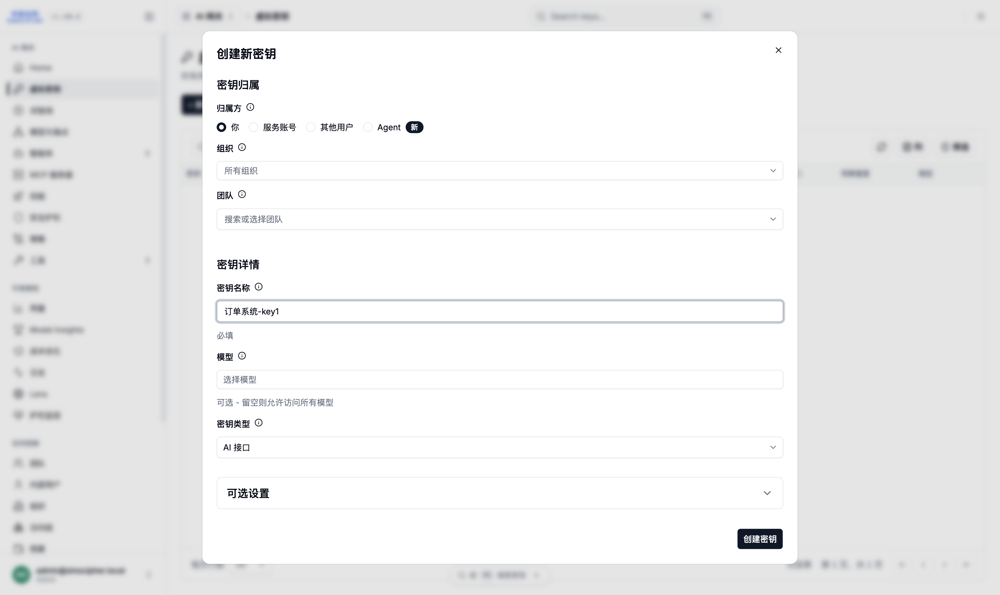

限流相关字段：

| 字段 | 含义 |
|---|---|
| 每分钟 Token 限制（TPM） | 该密钥每分钟可消耗的 Token 上限，不能超过团队 TPM 限制 |
| TPM 速率限制类型 | TPM 的计量方式，如滑动窗口或固定窗口 |
| 每分钟请求限制（RPM） | 该密钥每分钟可发起的请求数上限 |
| RPM 速率限制类型 | RPM 的计量方式 |
| 按标签速率限制 | 按请求标签分别限流 |
| 超出预算时限流 | 预算耗尽时降低速率而不是直接拒绝 |

其余可选设置：

| 字段 | 含义 |
|---|---|
| 启用提示词缓存 | 对该密钥启用上游提示词缓存，重复前缀可降低费用 |
| 护栏 | 给该密钥挂载护栏，可从已有护栏选择或输入新名称 |
| 禁用全局护栏 | 让该密钥绕过全局护栏，一般用于特殊业务 |
| 策略 / 提示词 | 按密钥绑定访问策略或提示词模板，属于高级功能 |
| 访问组 | 将密钥分配给访问组，继承该组的模型访问范围 |
| 允许的透传路由 | 限制该密钥可调用的透传端点 |
| 允许的向量存储 | 限制可访问的向量存储 |
| 元数据 / 标签 | 自定义键值与请求标签，便于统计归属 |

表单下方还有 MCP 设置、Agent 设置、技能设置、日志设置、路由设置、模型别名、密钥生命周期、高级设置等折叠区，日常创建保持默认即可

**步骤六：创建并保存密钥**

点击 `创建密钥`，成功后弹出保存窗口

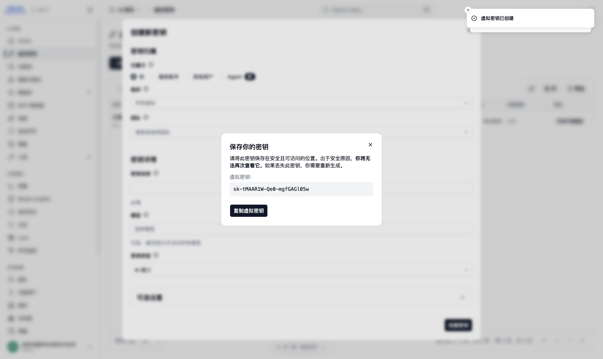

窗口提示：请将此密钥保存在安全且可访问的位置，出于安全原因你将无法再次查看它。如果丢失需要重新生成

| 元素 | 说明 |
|---|---|
| 虚拟密钥 | 完整密钥，以 `sk-` 开头 |
| 复制虚拟密钥 | 一键复制到剪贴板 |
| 关闭 | 关闭窗口 |

密钥只在此刻完整展示一次。请立即点击 `复制虚拟密钥` 保存到密码管理器等安全位置；遗失只能在列表中删除旧密钥后重新创建

---

## 三、访问控制

### 3.1 团队管理

#### 3.1.1 进入团队页面

左侧菜单 `访问控制` 分组下点击 **团队**，地址为 `<网关地址>/ui/teams/`

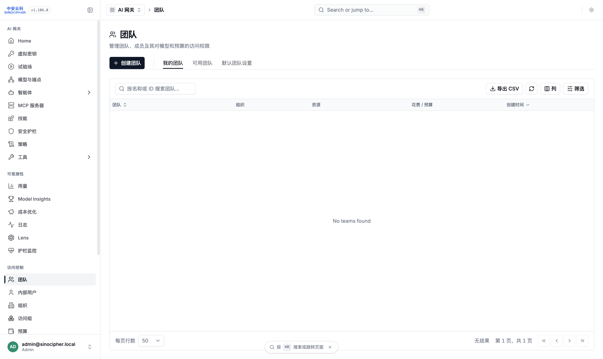

页面标题为「团队」，说明为「管理团队、成员及其对模型和预算的访问权限」

顶部有三个标签页：

| 标签页 | 作用 |
|---|---|
| 我的团队 | 你是成员的团队 |
| 可用团队 | 你可以加入的团队 |
| 默认团队设置 | 新团队创建时使用的默认配置模板 |

表格字段：

| 字段 | 含义 |
|---|---|
| 团队 | 团队名称与 ID |
| 组织 | 团队所属组织 |
| 资源 | 团队下的成员、密钥等资源数量 |
| 花费 / 预算 | 团队已消费金额与预算上限 |
| 创建时间 | 创建时间 |
| 操作 | 编辑、删除、成员管理等 |

右上角 `导出 CSV` 可把团队列表导出为表格文件

#### 3.1.2 创建团队：分步操作

**步骤一：点击创建团队**

点击右上角 `创建团队`

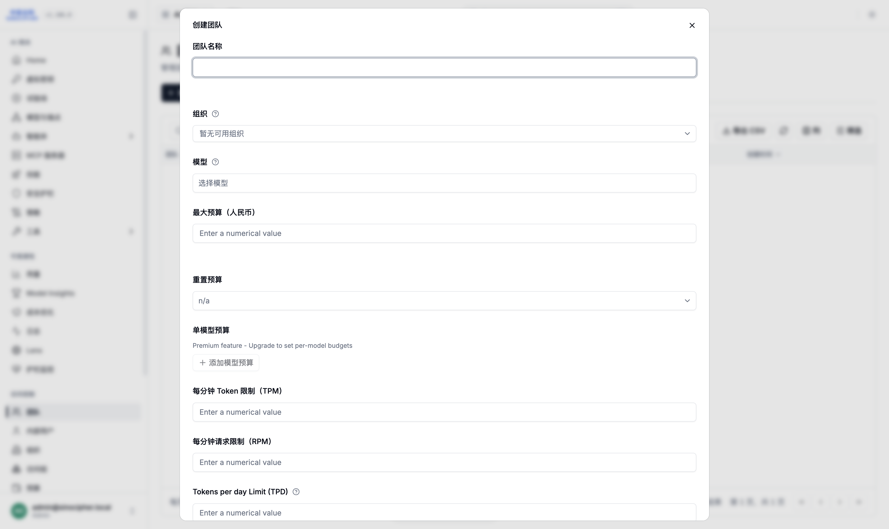

**步骤二：填写团队名称**

在「团队名称」中填写名称，建议与组织架构一致，例如「研发中心」

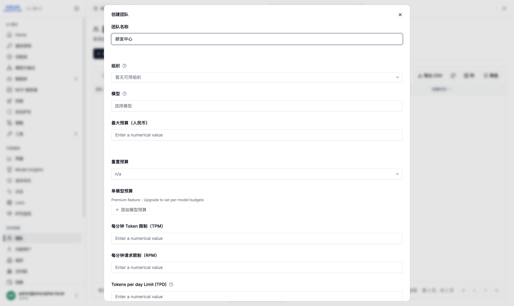

基础字段说明：

| 字段 | 含义 | 是否必填 |
|---|---|---|
| 团队名称 | 团队显示名称 | 是 |
| Organization | 团队所属组织，用于组织级汇总 | 否 |
| Models | 该团队可访问的模型范围，留空表示不限制 | 否 |

**步骤三：设置团队预算**

在「最大预算（人民币）」中填写团队整体消费上限

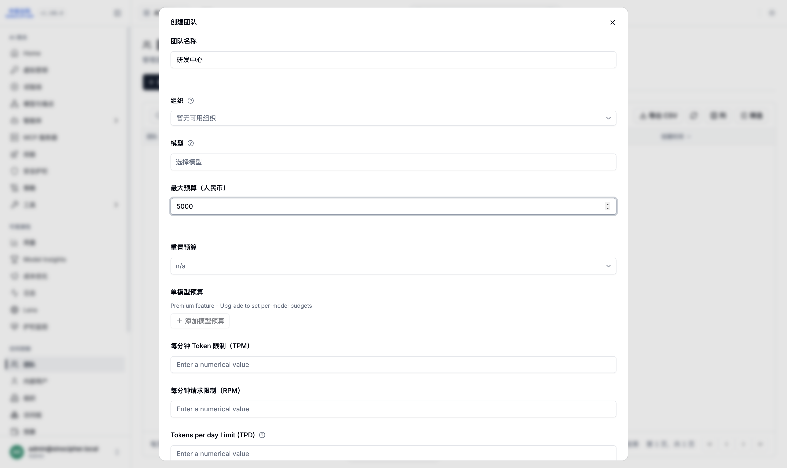

预算与限流字段：

| 字段 | 含义 |
|---|---|
| 最大预算（人民币） | 团队整体消费上限，团队下所有密钥消费合计不能超过该值 |
| 重置预算 | 团队预算的重置周期 |
| 单模型预算 | 按模型设置独立预算，属于高级功能 |
| 添加模型预算 | 为指定模型单独设置预算上限 |
| Tokens per day Limit (TPD) | 团队每日 Token 用量上限 |
| 元数据 | 自定义键值对。值按文本保存，类型化值请输入 JSON，例如 3、true 或 {"region": "us"} |

**步骤四：设置团队限流**

填写 TPM 与 RPM

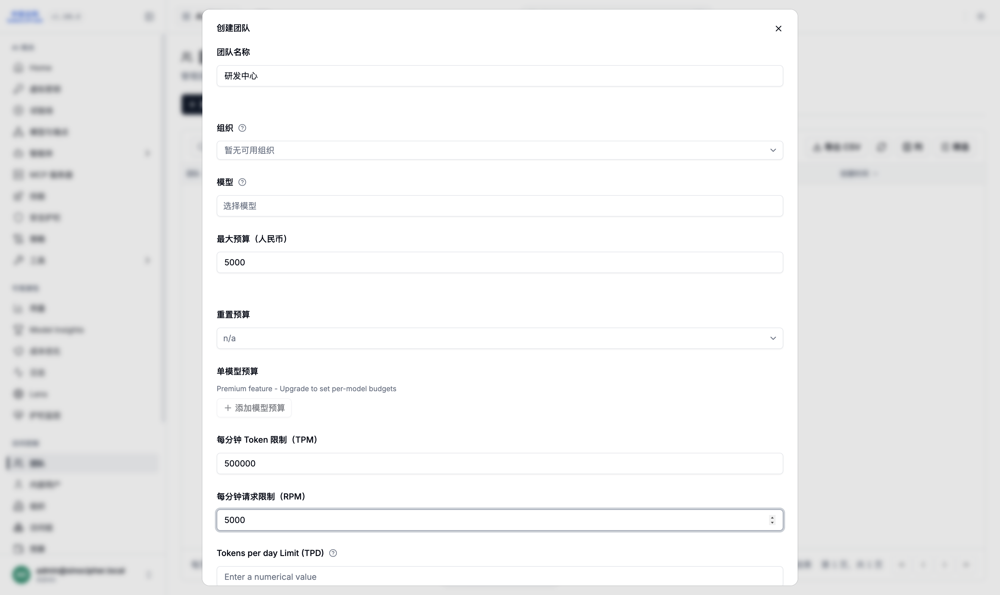

| 字段 | 含义 |
|---|---|
| 每分钟 Token 限制（TPM） | 团队整体每分钟 Token 上限，团队下密钥的 TPM 不能超过该值 |
| 每分钟请求限制（RPM） | 团队整体每分钟请求数上限 |

**步骤五：展开附加设置**

点击「附加设置」展开进阶配置

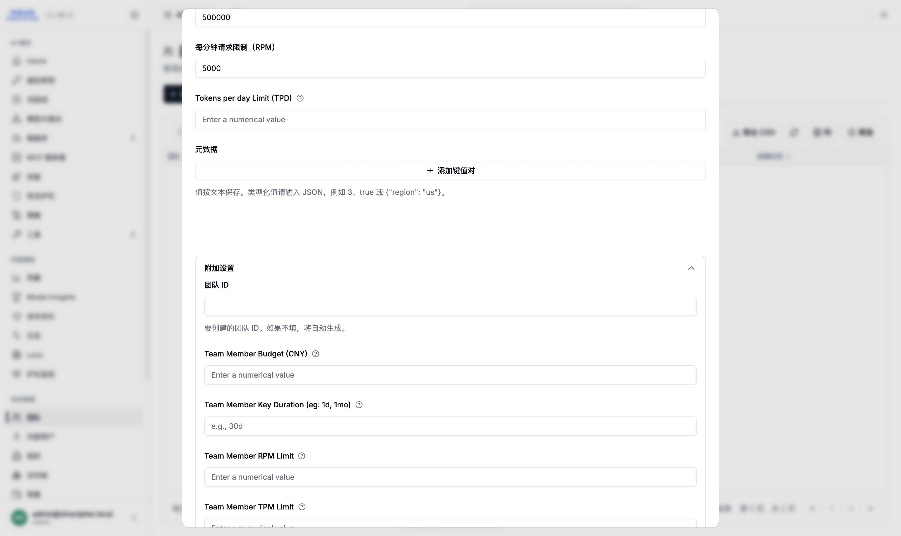

附加设置字段：

| 字段 | 含义 |
|---|---|
| 团队 ID | 要创建的团队 ID，不填则系统自动生成。需要与外部系统对齐 ID 时才手工指定 |
| Team Member Budget (CNY) | 团队成员默认预算上限，单位人民币 |
| Team Member Key Duration | 团队成员创建的密钥默认有效期，例如 `1d`、`1mo` |
| Team Member RPM Limit | 团队成员默认每分钟请求上限 |
| Team Member TPM Limit | 团队成员默认每分钟 Token 上限 |
| 密钥管理器设置 | 对接外部密钥管理器，属于高级功能 |
| Guardrails | 为该团队挂载护栏，团队下密钥默认继承 |
| Disable Global Guardrails | 是否禁用全局护栏，属于高级功能 |
| Policies | 为该团队绑定访问策略 |
| Access Groups | 把团队加入访问组，继承该组的模型访问范围 |
| Allowed Vector Stores | 该团队可访问的向量存储，留空表示不限制 |
| Allowed Pass Through Routes | 该团队可使用的透传路由 |
| Allowed MCP Servers | 该团队可访问的 MCP 服务器或访问组 |
| Allowed Agents | 该团队可访问的 Agent 或访问组 |
| Allowed Search Tools | 限制该团队密钥可调用的搜索工具 |
| Allowed Skills | 该团队密钥在 Claude Code 市场中可见的私有技能 |
| 日志设置 | 日志投递目标，如 langfuse-logging、datadog-logging，属于高级功能 |
| 路由设置 | 负载均衡、回退、路由策略、标签过滤与重试等参数，包括允许失败次数、冷却时间、重试次数、超时时间、重试等待 |
| 模型分组别名 / 模型别名 | 为模型组和模型设置对外别名，别名名称与目标模型一一对应 |

填写完成后保存，团队即创建成功

### 3.2 内部用户管理

#### 3.2.1 进入内部用户页面

左侧菜单 `访问控制` 分组下点击 **内部用户**，地址为 `<网关地址>/ui/users/`

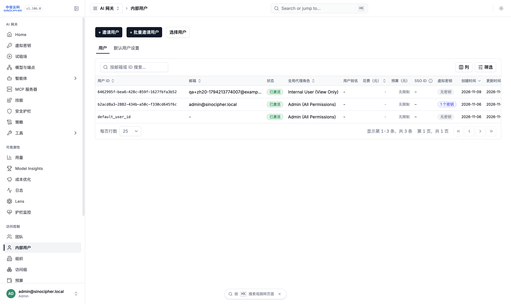

顶部有两个标签页：`用户` 与 `默认用户设置`，后者配置新用户的默认角色与默认预算

表格字段：

| 字段 | 含义 |
|---|---|
| 用户 ID | 用户唯一标识 |
| 邮箱 | 用户登录账号 |
| 状态 | 账号状态 |
| 全局代理角色 | 用户全局权限角色 |
| 用户别名 | 用户显示名称 |
| 花费（元） | 该用户累计消费 |
| 预算（元） | 该用户预算上限 |
| SSO ID | 若通过单点登录接入，显示外部身份 ID |
| 虚拟密钥 | 该用户名下密钥数量 |
| 创建时间 | 创建时间 |
| 更新时间 | 最近修改时间 |
| 操作 | 编辑、重置密码、复制用户 ID、删除用户 |

#### 3.2.2 邀请用户：分步操作

**步骤一：点击邀请用户**

点击右上角 `+ 邀请用户`

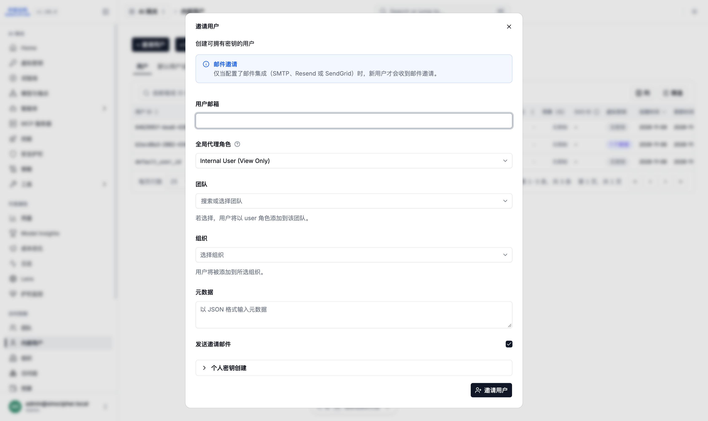

表单顶部说明为「创建可拥有密钥的用户」，并提示仅当配置了邮件集成（SMTP、Resend 或 SendGrid）时，新用户才会收到邮件邀请

**步骤二：填写用户邮箱**

在「用户邮箱」中填写新用户邮箱，该邮箱同时作为登录账号

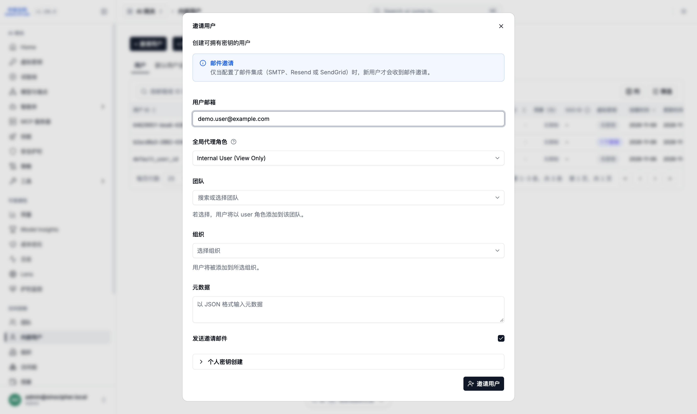

表单字段说明：

| 字段 | 含义 | 是否必填 |
|---|---|---|
| 用户邮箱 | 新用户邮箱，同时作为登录账号 | 是 |
| 全局代理角色 | 权限范围。可选 `Internal User (View Only)` 只读、`Internal User (Create/Delete/View)` 可管理自己的密钥、`Admin (View Only)` 只读管理员、`Admin (All Permissions)` 完全管理员，默认只读 | 是 |
| 团队 | 若选择，用户将以 `user` 角色加入该团队，继承团队预算与模型范围 | 否 |
| 组织 | 用户将被添加到所选组织 | 否 |
| 元数据 | 自定义键值对，用于记录部门、工号等信息 | 否 |
| 发送邀请邮件 | 是否发送邮件通知。未配置邮件服务时无效，需要手动复制邀请链接 | 否 |

**步骤三：展开个人密钥创建**

点击「个人密钥创建」展开模型授权配置

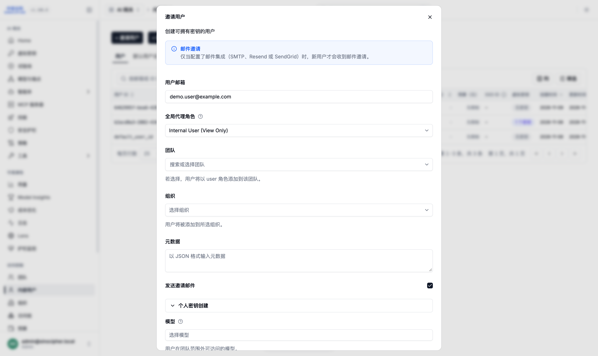

该折叠区包含：

| 字段 | 含义 |
|---|---|
| 模型 | 用户在团队范围外可访问的模型。即使不属于任何团队，也能通过该设置获得模型访问权限 |

这一项容易被忽略。如果用户不属于任何团队，且这里也没有配置模型，用户创建密钥后调用会返回 403，提示没有模型访问权限

**步骤四：提交并复制邀请链接**

填写完成后点击 `邀请用户`，成功后弹出邀请链接窗口，显示 User ID 与 Invitation Link。点击复制按钮把链接发给用户

链接格式为：

```
<网关地址>/ui/onboarding?invitation_id=xxxxxxxx-xxxx-xxxx-xxxx-xxxxxxxxxxxx
```

用户打开链接后设置密码即完成注册。邀请链接有效期 7 天，失效后可在用户列表的操作菜单里选择重置密码，生成新的重置链接

#### 3.2.3 用户操作菜单

| 菜单项 | 作用 |
|---|---|
| 编辑用户 | 修改角色、预算、模型范围等 |
| 重置密码 | 生成重置密码链接 |
| 复制用户 ID | 复制用户 ID 到剪贴板 |
| 删除用户 | 删除该用户，名下密钥需另行处理 |

使用 `+ 批量邀请用户` 可以一次导入多个用户，适合新团队批量开通

---

## 四、可观测性

### 4.1 用量

#### 4.1.1 查看用量总览

左侧菜单 `可观测性` 分组下点击 **用量**，地址为 `<网关地址>/ui/usage/`

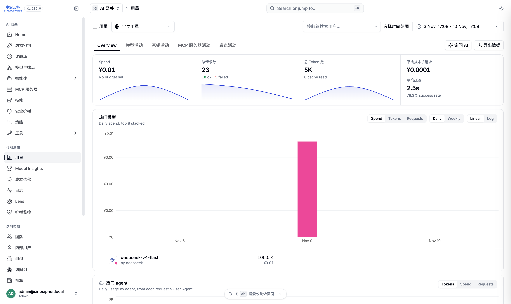

顶部控制区：

| 控件 | 作用 |
|---|---|
| 全局用量 | 在全局用量与个人用量之间切换。管理员可看全局，普通用户默认只看自己 |
| 选择时间范围 | 统计区间，默认最近 7 天 |
| 询问 AI | 用自然语言提问用量，例如「哪个模型最花钱」 |
| 导出数据 | 导出用量报表 |

标签页与统计维度：

| 标签页 | 统计维度 |
|---|---|
| Overview | 总体指标与趋势，默认页 |
| 模型活动 | 按模型统计调用次数、Token 与费用 |
| 密钥活动 | 按密钥统计消费与占比 |
| MCP 服务器活动 | 按 MCP 服务器统计调用 |
| 端点活动 | 按网关端点统计请求分布 |

Overview 指标卡片：

| 指标 | 含义 |
|---|---|
| Spend | 所选区间总消费，单位人民币 |
| 预算提示 | 未设置预算显示 No budget set，已设置显示预算使用进度 |
| 总请求数 | 区间内请求总数，并区分成功与失败 |
| 总 Token 数 | 区间内消耗的 Token 总量，并显示缓存读取量 |
| 平均成本 / 请求 | 总消费除以总请求数 |
| 平均延迟 | 请求平均耗时 |
| success rate | 成功率，等于成功数除以总数 |

页面下方依次为「热门模型」「热门 agent」「按提供商统计花费」「热门虚拟密钥」图表，可切换 Spend、Tokens、Requests 统计口径与 Daily、Weekly、Linear、Log 呈现方式

#### 4.1.2 按模型查看用量

切换到 `模型活动` 标签页

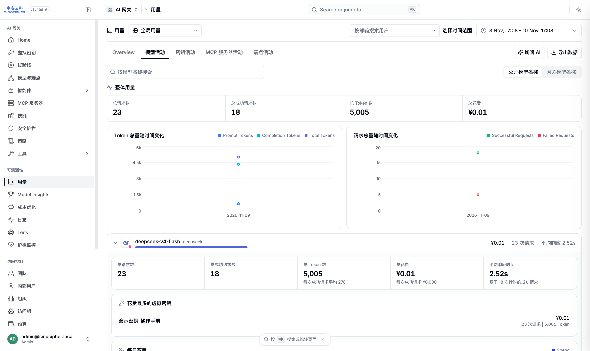

该页按模型列出调用次数、Token 用量、消费金额与占比，用于判断哪个模型成本最高

#### 4.1.3 按密钥查看用量

切换到 `密钥活动` 标签页

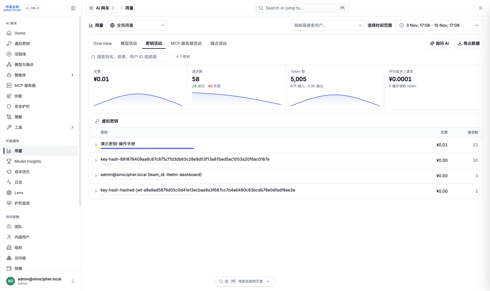

该页按密钥列出消费金额与占比，配合密钥别名可定位具体业务系统

#### 4.1.4 导出用量数据

点击 `导出数据`，弹出导出窗口

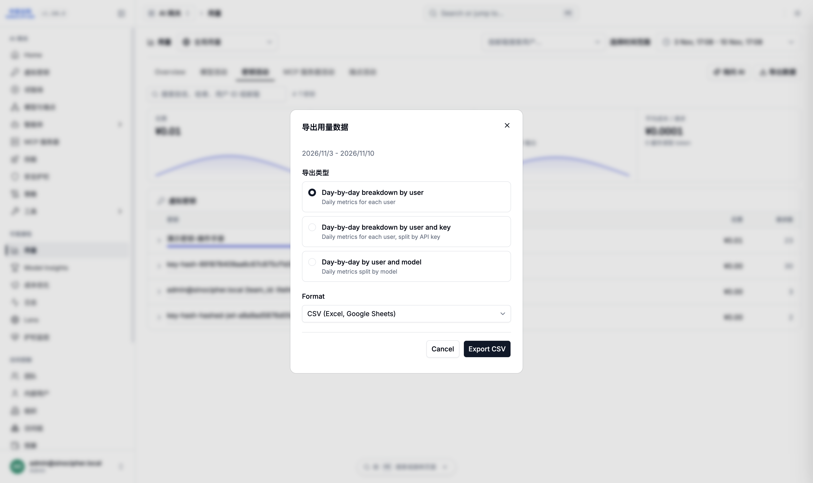

| 字段 | 含义 |
|---|---|
| 导出类型 | 报表粒度，可按用户、按用户与密钥、按用户与模型做每日拆分 |
| Format | 导出文件格式，当前支持 CSV，可用 Excel 或 Google Sheets 打开 |

窗口顶部显示本次导出的日期范围，即页面所选区间。确认后点击导出按钮下载

### 4.2 日志

#### 4.2.1 查看请求日志

左侧菜单 `可观测性` 分组下点击 **日志**，地址为 `<网关地址>/ui/logs/`

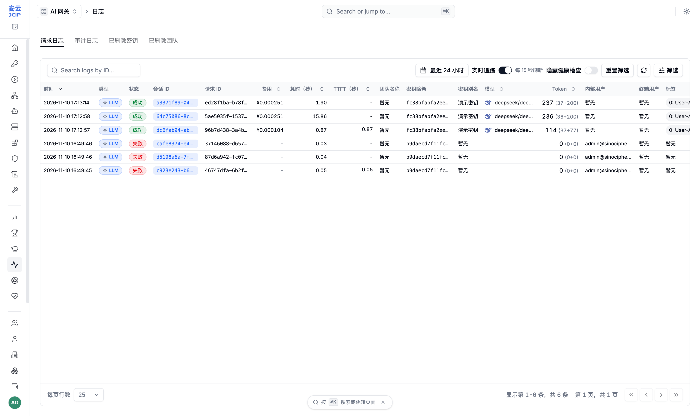

顶部四个标签页：

| 标签页 | 内容 |
|---|---|
| 请求日志 | 模型请求记录，排查主入口 |
| 审计日志 | 管理操作记录，如创建密钥、修改团队 |
| 已删除密钥 | 已删除密钥的历史记录 |
| 已删除团队 | 已删除团队的历史记录 |

请求日志工具栏：

| 控件 | 作用 |
|---|---|
| 最近 24 小时 | 时间范围选择，默认最近 24 小时 |
| 实时追踪 | 自动滚动并持续加载最新请求 |
| 每 15 秒刷新 | 开关自动刷新 |
| 隐藏健康检查 | 过滤网关自身的健康检查请求 |
| 重置筛选 | 清空全部筛选条件 |
| 筛选 | 打开筛选面板 |

列表字段：

| 字段 | 含义 |
|---|---|
| 时间 | 请求发生时间 |
| 类型 | 请求类型，如 LLM 调用、健康检查 |
| 状态 | 成功或失败 |
| 会话 ID | 同一会话的多次请求共享，便于串联多轮对话 |
| 请求 ID | 单次请求唯一标识 |
| 费用 | 该次请求消费，单位人民币 |
| 耗时（秒） | 从发出请求到收到完整响应的总耗时 |
| TTFT（秒） | 首 Token 时间，从发出请求到收到第一个 Token |
| 团队名称 | 发起请求的团队 |
| 密钥哈希 | 所用密钥的哈希值，用于定位密钥而不暴露明文 |
| 密钥别名 | 所用密钥的别名 |
| 模型 | 实际调用的模型名 |
| Token | 该次请求消耗的 Token 总数 |
| 内部用户 | 发起请求的网关用户 |
| 终端用户 | 请求携带的终端用户标识 |
| 标签 | 请求携带的标签 |

#### 4.2.2 筛选日志

**步骤一：打开筛选面板**

点击 `筛选`

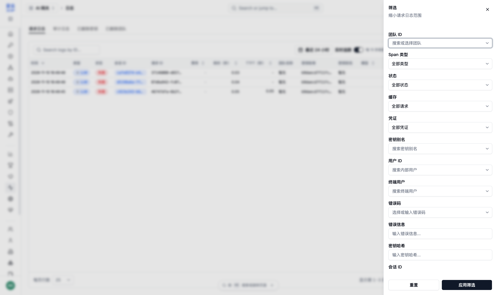

筛选字段说明：

| 筛选项 | 含义 |
|---|---|
| 团队 ID | 按团队过滤 |
| Span 类型 | 按调用链路中的 Span 类型过滤，默认全部类型 |
| 状态 | 按成功或失败过滤，默认全部状态 |
| 缓存 | 按是否命中提示词缓存过滤，默认全部请求 |
| 凭证 | 按使用的上游凭据过滤，默认全部凭证 |
| 密钥别名 | 按密钥别名过滤 |
| 用户 ID | 按内部用户过滤 |
| 终端用户 | 按终端用户标识过滤 |
| 错误码 | 按 HTTP 错误码过滤 |
| 错误信息 | 按错误文本模糊匹配 |
| 密钥哈希 | 按密钥哈希过滤 |
| 会话 ID | 按会话过滤，用于查看完整多轮对话 |
| 模型 | 按模型名过滤 |
| 公共模型 / 搜索工具 | 按对外模型名或搜索工具过滤 |

**步骤二：填写筛选条件**

选择需要过滤的字段，例如按模型过滤

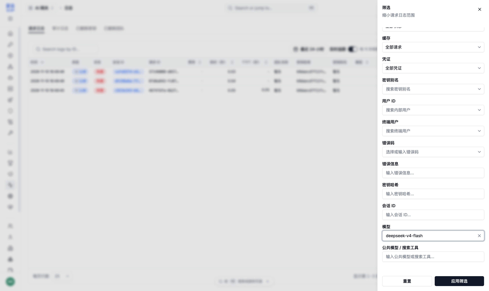

填好后点 `应用筛选` 生效，点 `重置` 清空条件，点 `关闭` 收起面板

#### 4.2.3 查看请求详情

点击任意一条日志，从右侧滑出详情抽屉

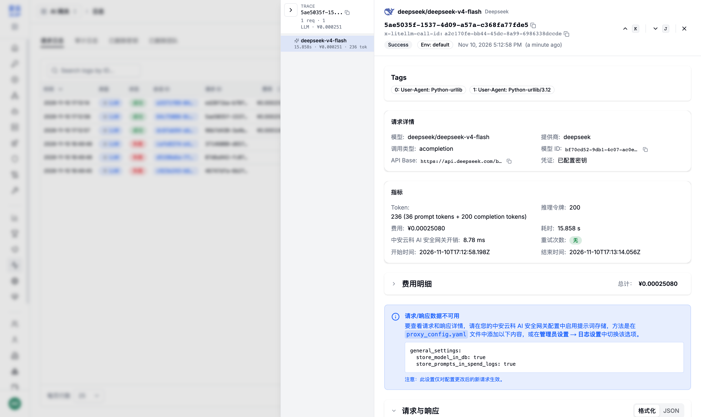

详情分几块：

| 区域 | 内容 |
|---|---|
| 顶部 TRACE | 请求 ID、模型、耗时、费用、Token 数、提供商、状态与时间，以及请求携带的 Tags |
| 请求详情 | 模型、提供商、调用类型、模型 ID、API Base、凭证 |
| 指标 | Token（拆分输入与输出）、推理令牌、费用、耗时、首 Token 延迟、网关上开销、重试次数、开始与结束时间 |
| 费用明细 | 本次请求成本构成，可核对输入、输出、缓存各部分计费 |
| 工具 | 本次请求提供给模型的工具，以及实际调用了哪些 |
| 请求与响应 | 在 Pretty 与 JSON 视图间切换，查看完整消息与响应原文 |

排查计费异常时，重点看「费用明细」与「指标」中的缓存读取量，缓存命中的输入按更低单价计费

### 4.3 成本优化

左侧菜单 `可观测性` 分组下点击 **成本优化**，地址为 `<网关地址>/ui/cost-optimization/`

页面说明为：跟踪并配置可为你省钱的机制，即提示词压缩与提示词缓存，自动路由位于「模型 + 端点」的「自动路由」标签页

页面标注「这是一个实验性面板」，并说明花费按 UTC 日期分桶，因此统计日期与本地时间可能相差 8 小时

四个标签页：`总览`、`提示词压缩`、`提示词缓存`、`自动路由`

#### 4.3.1 总览

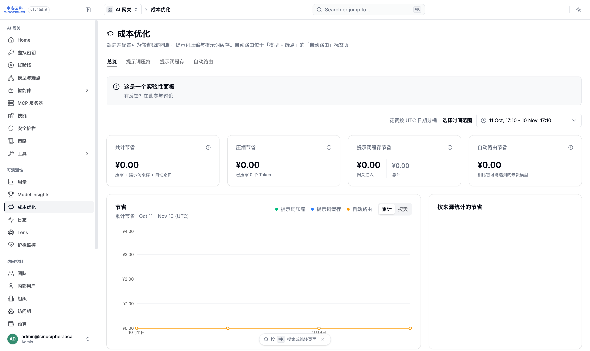

| 字段 | 含义 |
|---|---|
| 共计节省 | 所选区间内通过压缩、缓存、路由总共节省的金额 |
| 压缩节省 | 提示词压缩带来的节省 |
| 已压缩 | 经过压缩的请求数 |
| 提示词缓存节省 | 命中提示词缓存带来的节省 |
| 网关注入 | 网关主动注入缓存标记带来的节省 |
| 自动路由节省 | 自动路由选择更便宜模型带来的节省 |

可按时间范围查看趋势，评估各项优化措施的实际收益

#### 4.3.2 提示词压缩

该页配置 Headroom 压缩护栏，字段说明见 2.2.3

#### 4.3.3 提示词缓存

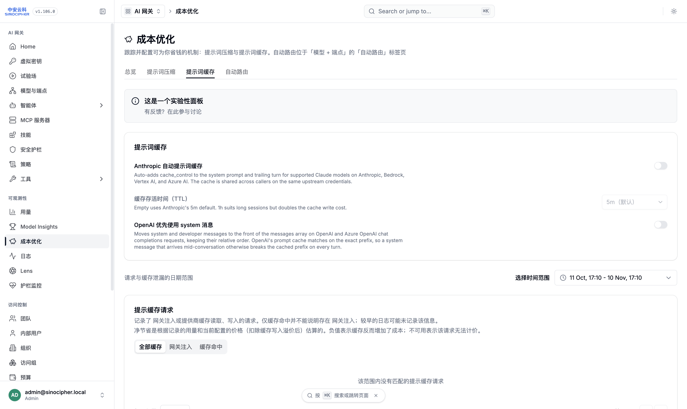

| 字段 | 含义 |
|---|---|
| Anthropic 自动提示词缓存 | 自动为 Anthropic、Bedrock、Vertex AI、Azure AI 上的 Claude 模型添加 `cache_control` 系统提示与轮次，缓存在使用同一上游凭据的调用方之间共享 |
| 缓存存活时间（TTL） | 缓存保留时长。留空使用 Anthropic 默认的 5 分钟；1 小时适合长会话，但缓存写入成本翻倍 |
| OpenAI 优先使用 system 消息 | 在 OpenAI 与 Azure OpenAI 请求中把 system 与 developer 消息前移并保持顺序。OpenAI 的提示词缓存按精确前缀匹配，中途插入消息会破坏缓存前缀 |
| 请求与缓存泄漏的日期范围 | 选择统计区间 |
| 提示缓存请求 | 列出网关注入或提供商缓存读取、写入的请求。仅缓存命中并不能说明存在网关注入 |
| 净节省 | 根据记录用量与当前配置价格估算，已扣除缓存写入溢价。负值表示缓存反而增加成本 |

#### 4.3.4 自动路由

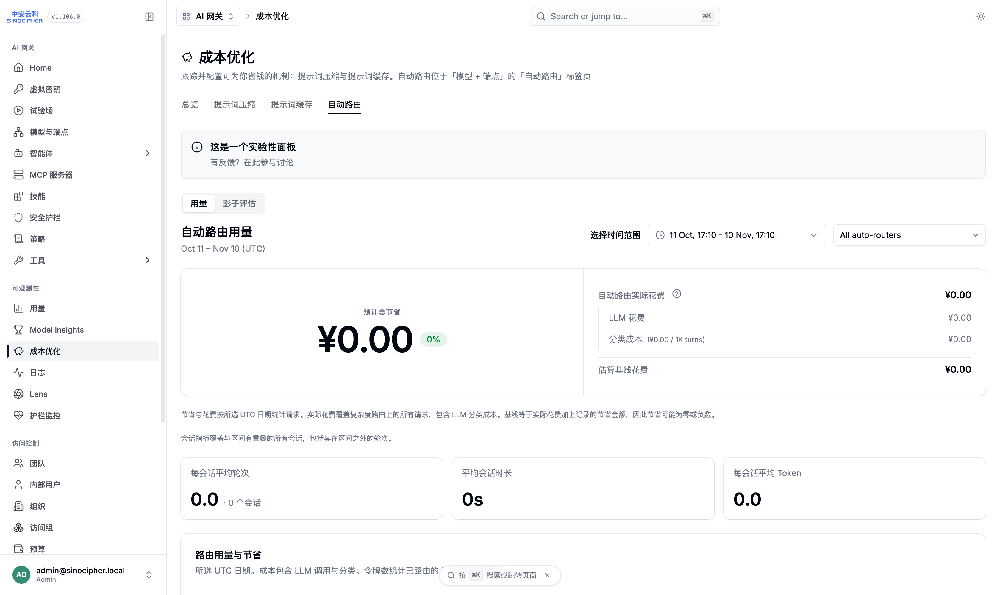

自动路由按规则把请求分发到不同模型，例如简单问题走便宜模型、复杂问题走强模型。该页展示路由规则的命中情况与节省效果，规则创建在「模型与端点」的 `自动路由` 标签页完成

---

## 五、设置

### 5.1 授权管理

左侧菜单最下方 `设置` 分组下点击 **设置**，进入授权信息页面，地址为 `<网关地址>/ui/product-license/`

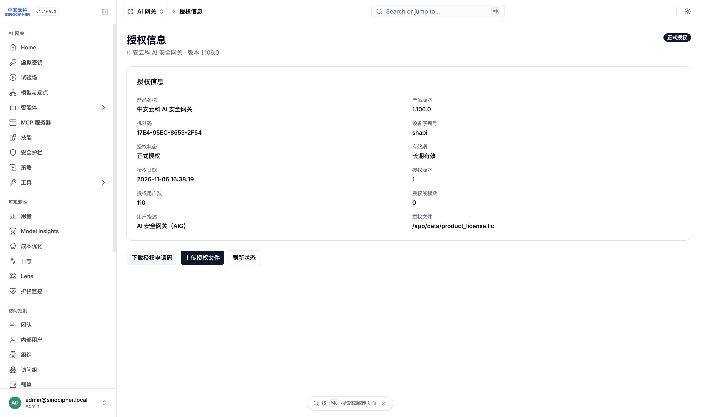

页面顶部显示产品名称与版本，右侧徽标显示授权状态

授权信息字段：

| 字段 | 含义 |
|---|---|
| 产品名称 | 被授权的产品名 |
| 产品版本 | 当前运行版本 |
| 机器码 | 本机唯一机器码，申请授权时提供给授权方 |
| 设备序列号 | 设备序列号，用于标识硬件 |
| 授权状态 | 授权类型，如正式授权、试用授权、未授权 |
| 有效期 | 授权到期时间，长期授权显示为长期有效 |
| 授权日期 | 授权生效时间 |
| 授权版本 | 授权文件版本号 |
| 授权用户数 | 允许接入的用户数量上限 |
| 授权线程数 | 允许的并发线程数上限，0 表示不限制 |
| 用户描述 | 授权对应的客户或项目描述 |
| 授权文件 | 授权文件在服务器上的路径 |

页面底部三个操作：

| 操作 | 作用 |
|---|---|
| 下载授权申请码 | 生成申请码文件，提交给授权方换取正式授权文件 |
| 上传授权文件 | 上传授权方下发的 `.lic` 文件，上传后立即生效 |
| 刷新状态 | 重新读取授权文件，用于排查授权未生效的问题 |

更换授权或扩容的流程：先点 `下载授权申请码` 拿到本机申请码发给授权方；收到 `.lic` 文件后点 `上传授权文件` 选择文件；上传完成点 `刷新状态` 确认授权状态、有效期与用户数已更新

升级版本后需要重新确认授权。产品版本变化可能导致原授权失效，升级后应回到本页检查状态，必要时重新上传授权文件

---

## 六、附录

### 6.1 常见问题

| 现象 | 原因 | 处理 |
|---|---|---|
| 登录提示用户名或密码错误 | 账号或密码不正确 | 核对账号；忘记密码联系管理员生成重置链接 |
| 调用返回 401 | 密钥错误、已删除或已过期 | 核对密钥是否完整复制；在虚拟密钥页面重建 |
| 调用返回 403，提示没有模型访问权限 | 用户没有配置模型范围，且不属于任何有权模型访问的团队 | 联系管理员在用户编辑页或个人密钥创建的模型字段中补配 |
| 调用返回 400，提示没有可用部署 | 请求的模型名不存在或未部署 | 核对公开模型名称；联系管理员确认模型已部署 |
| 调用返回 429 | 触发 TPM 或 RPM 限流，或所有部署进入冷却 | 降低请求频率；长期不足联系管理员调整限额 |
| 日志页看不到刚才的请求 | 时间范围默认最近 24 小时，或请求被隐藏健康检查过滤 | 调整时间范围；关闭隐藏健康检查 |
| 花费与上游账单对不上 | 自定义定价未配置，或缓存计费口径差异 | 检查模型的自定义定价；在日志详情核对费用明细 |
| 授权状态显示异常 | 授权文件缺失或版本升级后授权失效 | 在授权信息页点刷新状态，必要时重新上传授权文件 |

### 6.2 术语说明

| 术语 | 含义 |
|---|---|
| 虚拟密钥 | 网关签发的调用凭证，以 `sk-` 开头，用于业务系统调用模型 |
| 公开模型名称 | 业务方在请求里填写的模型名，由网关映射到实际上游模型 |
| 网关模型名称 | 网关发往上游 API 的真实模型名 |
| 部署 | 一个模型的一条上游接入配置，同一模型名可有多个部署做负载均衡 |
| TPM / RPM | 每分钟 Token 数 / 每分钟请求数，用于限流 |
| TPD | 每日 Token 数上限 |
| 提示词缓存 | 上游对重复前缀的输入按更低单价计费，可显著降低成本 |
| 提示词压缩 | 请求发给模型前移除冗余内容，减少输入 Token |
| 护栏 | 在请求或响应上执行的检查与处理逻辑，压缩护栏属于其中一种 |
| TTFT | 首 Token 时间，从发出请求到收到第一个 Token 的耗时 |
