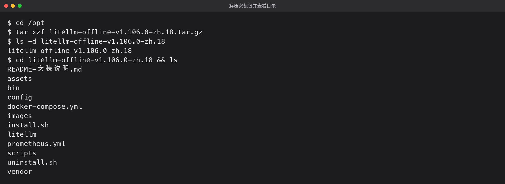
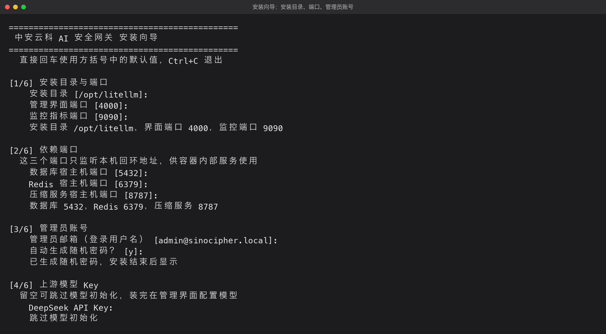
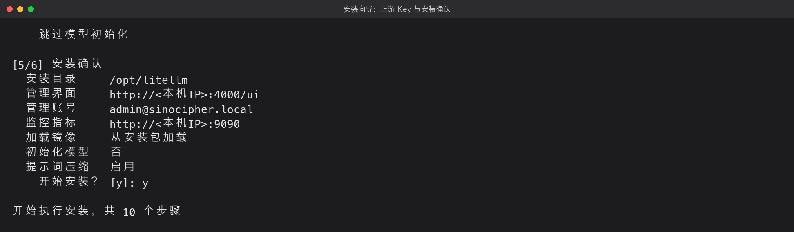
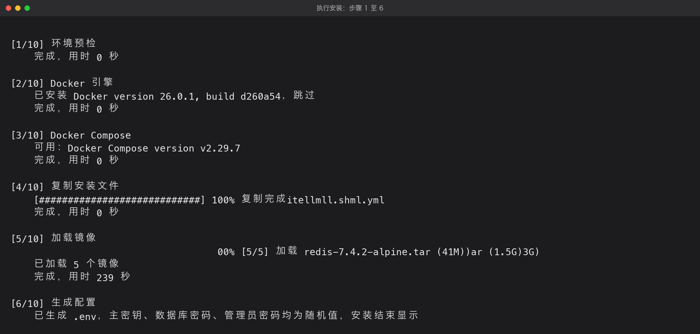
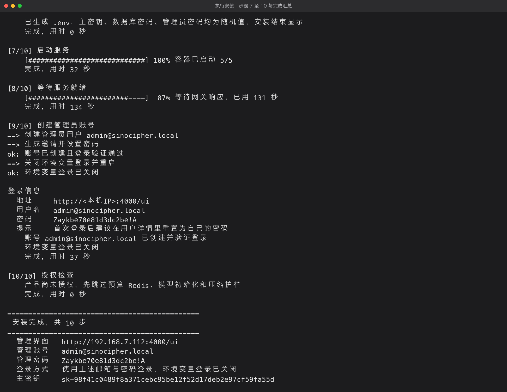
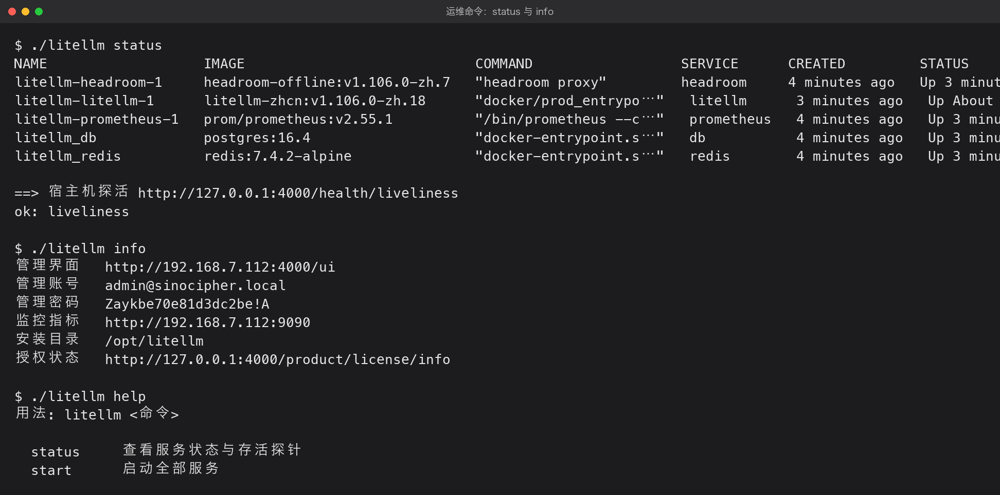
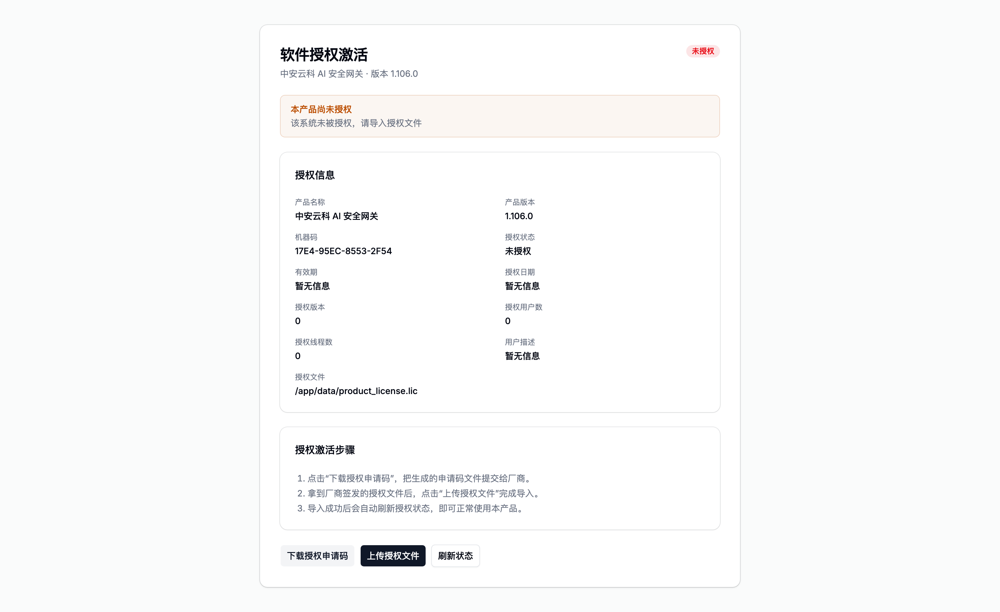
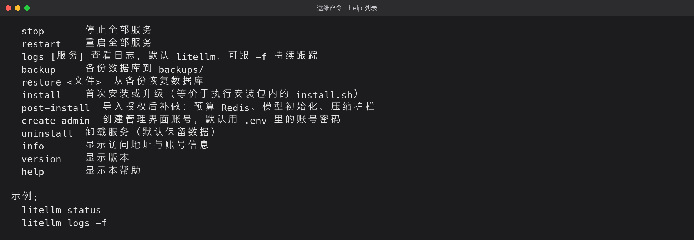
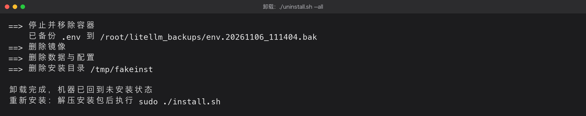

# 中安云科 AI 安全网关 离线安装包使用教程

版本 v1.0，适用安装包 `litellm-offline-v1.106.0-zh.18.tar.gz`，适用产品版本 v1.106.0-zh.18

本教程面向实施与运维人员，说明如何在一台全新的 Linux 服务器上使用离线安装包完成部署、激活授权，以及日常启停、日志查看、备份与卸载。全程不需要外网。

安装包自带产品运行所需的一切：五个容器镜像、Docker 引擎、Docker Compose 二进制、编排文件、初始化脚本和运维命令。目标机只需要一个干净的 64 位 Linux 系统。

## 1 概述

### 1.1 环境要求

| 项目 | 要求 |
| --- | --- |
| 操作系统 | Linux x86_64，使用 systemd（麒麟 V10、CentOS 7 以上、Ubuntu 18.04 以上均可） |
| CPU 与内存 | 2 核 4 GiB 起，建议 4 核 8 GiB |
| 磁盘 | 至少 20 GiB 可用空间，安装包约 1.3 GiB，镜像展开约 3.5 GiB |
| 权限 | root，或具备 sudo 权限的账号 |
| 网络 | 无需外网，管理界面与模型调用走内网即可 |
| 端口 | 默认占用 4000 管理界面、9090 监控、5432、6379、8787 仅本机回环 |

目标机已有 Docker 也可以，安装脚本会自动识别并跳过引擎安装。如需强制跳过，安装时加 `--skip-docker`。

### 1.2 安装包结构

| 路径 | 说明 |
| --- | --- |
| `install.sh` | 安装入口，不带参数为交互式向导 |
| `litellm` | 安装后的运维入口，提供启停、状态、日志、备份等命令 |
| `uninstall.sh` | 卸载脚本，支持保留数据、清空数据、完全卸载三种模式 |
| `docker-compose.yml` | 容器编排定义，含授权状态持久化挂载 |
| `images/*.tar` | 五个容器镜像，docker load 即可 |
| `vendor/docker/` | Docker 26.0.1 静态二进制与 systemd 配置 |
| `bin/docker-compose` | Compose v2 静态二进制，目标机无需安装插件 |
| `config/config.yaml` | 模型存库模式的配置 |
| `scripts/` | 启动、停止、状态、备份恢复、模型初始化等脚本 |
| `README-安装说明.md` | 随包说明，与本教程互为补充 |

## 2 安装前准备

把安装包上传到目标机的 `/opt` 目录，执行下面的解压命令。解压本身不做任何系统改动，只是把镜像、脚本和配置展开到目录里。

```bash
cd /opt
tar xzf litellm-offline-v1.106.0-zh.18.tar.gz
ls -d litellm-offline-v1.106.0-zh.18
```

命令执行完会得到一个与安装包同名的目录，例如 `litellm-offline-v1.106.0-zh.18`，进入后可以看到完整的安装文件，包括镜像目录 `images`、安装脚本 `install.sh` 和运维命令 `litellm`。

解压出的目录名随安装包版本变化。升级到新版本后目录名也会跟着变，例如换成 zh.19 的包解压出来就是 `litellm-offline-v1.106.0-zh.19`。执行后续命令时请按实际解压出来的目录名替换，或者直接用通配符匹配：

```bash
cd /opt/litellm-offline-v1.106.0-zh.*
```



如需解压到其它位置，用 `-C` 指定目标目录，例如 `tar xzf litellm-offline-v1.106.0-zh.18.tar.gz -C /data`。解压后的目录约 3.5 GiB，请确认目标分区有足够空间。

### 2.1 端口占用检查

安装向导会在选择端口时自动检测占用情况，被占用会提示重新输入。也可以提前手工确认。

```bash
ss -lntp | grep -E ':4000|:9090|:5432|:6379|:8787'
```

### 2.2 磁盘与内存检查

```bash
df -h /
free -g
```

磁盘不足 20 GiB 时安装会在复制镜像阶段失败，建议提前清理。

## 3 执行安装

进入解压目录后执行安装脚本。不带任何参数即进入交互式向导，全程按提示回车或输入即可。下面的目录名以 zh.18 为例，实际请用你解压出来的那个目录名。

```bash
cd /opt/litellm-offline-v1.106.0-zh.18
sudo ./install.sh
```

### 3.1 向导第 1 至 3 步：目录、端口、账号



第 1 步，安装目录与端口。默认安装到 `/opt/litellm`，管理界面端口默认 4000，监控端口默认 9090。端口被占用会立即提示并允许重填。

第 2 步，依赖端口。数据库、Redis、压缩服务三个端口只监听 127.0.0.1，供容器内部使用。同一台机器部署多套时需要改开，避免冲突。

第 3 步，管理员账号。这里填写管理员邮箱，同时作为登录用户名，默认 admin@sinocipher.local，必须是邮箱格式。密码可以选择自动生成随机值，也可以自己设置，系统密码策略要求至少 12 位，不足会要求重新输入。

### 3.2 向导第 4 至 5 步：上游 Key 与确认



第 4 步，上游模型 Key。填入 DeepSeek API Key 时，安装完成后会自动创建 deepseek-flash、deepseek-v4-pro 等模型分组，价格按官方峰谷价写入。留空则跳过，装好后在管理界面添加。

第 5 步，安装确认。这一步把前面所有选择列出来，确认无误后输入 y 开始安装，输入其他内容则取消退出，不会改动系统。

## 4 安装过程说明

确认后进入十个执行阶段。每个阶段都有编号、当前动作和耗时，长耗时步骤带进度条或计时，不会出现长时间无输出的等待。



| 阶段 | 动作 | 说明 |
| --- | --- | --- |
| 1/10 | 环境预检 | 检查 root 权限、systemd、磁盘与内存，不足时给出警告 |
| 2/10 | Docker 引擎 | 已安装则显示版本并跳过，否则解压内置的 26.0.1 静态包并注册服务 |
| 3/10 | Docker Compose | 使用包内自带的 v2.29.7 二进制，无需系统安装插件 |
| 4/10 | 复制安装文件 | 复制编排、脚本与配置，约 90 MiB，带百分比进度 |
| 5/10 | 加载镜像 | 逐个加载五个镜像并显示文件名、大小与耗时，已存在则自动跳过 |
| 6/10 | 生成配置 | 随机生成主密钥、数据库密码、管理员密码，写入 .env 并设为 600 权限 |
| 7/10 | 启动服务 | 拉起五个容器，实时显示已启动数量 |
| 8/10 | 等待服务就绪 | 持续探测健康接口，显示进度与已用时间，最长等待五分钟 |
| 9/10 | 创建管理员账号 | 用邀请方式创建独立密码的管理账号，成功后关闭环境变量登录作为兜底 |
| 10/10 | 授权检查 | 已授权则继续初始化模型与压缩护栏，未授权则跳过并给出后续指引 |



第 8 阶段耗时通常在一到两分钟，取决于机器性能。首次启动要初始化数据库结构，慢一些属于正常。

第 9 阶段创建管理员失败时不会中断安装，环境变量登录会保留作为兜底，排查后可执行 `./litellm create-admin` 重试。

## 5 安装结果确认

安装结束时终端会打印访问地址、管理账号、管理密码、主密钥和后续操作提示。这些信息只显示一次，同时保存在安装目录的 `.env` 文件里，请立即记录并妥善保管。



`./litellm status` 会打印五个容器状态并做一次存活探针。`./litellm info` 打印访问地址、账号和授权状态查询地址。

## 6 授权激活

产品需要导入授权文件才能对外提供服务。未授权状态下，打开管理界面会自动跳转到授权激活页，健康检查、登录页和授权接口保持可用，其余业务接口返回 403。



第 1 步，下载授权申请码。在激活页点击下载授权申请码，得到一个十六进制文本文件。这个文件包含本机设备信息，用于绑定机器。

第 2 步，提交厂商签发。把申请码文件发给厂商，厂商按申请码签发对应产品的授权文件，签发时可填写设备序列号与订单号。

第 3 步，上传授权文件。拿到签发文件后在激活页点击上传授权文件，选择文件提交。导入成功后页面提示授权有效，产品随即解锁。

导入成功后，激活页的“登录管理控制台”会先引导到登录页，登录后自动回到控制台。未登录直接打开控制台同样会跳到登录页，不会出现空白页面或接口报错。

第 4 步，补做初始化。未授权时安装脚本跳过了预算 Redis、模型初始化与压缩护栏，导入授权后执行一次补做命令。

```bash
cd /opt/litellm
./litellm post-install
```

申请码在导入成功前保持不变，重复下载不会让已签发的授权文件失效。授权状态保存在 `data/license/license.zayk`，容器重建或升级后依然有效，不需要重新导入。

## 7 授权信息查看

导入授权后，在管理界面左侧菜单进入授权信息，可以看到产品名称、版本、机器码、设备序列号、授权状态、有效期、授权日期、授权用户数等信息。

机器码由本机硬件指纹生成，用于识别主机。设备序列号来自厂商签发的授权文件，签发时填写，未填写时不显示该行。两者含义不同，前者适合与主机资产台账对应，后者适合与合同订单对应。

授权时间按北京时间显示。如需其他时区，修改 `.env` 中的 `LITELLM_PRODUCT_TIMEZONE` 后重启容器。

## 8 日常运维

安装目录下的 `litellm` 是统一运维入口。



| 命令 | 用途 |
| --- | --- |
| `./litellm status` | 查看五个容器状态并做存活探针 |
| `./litellm start` / `stop` / `restart` | 启动、停止、重启全部服务 |
| `./litellm logs` | 查看网关日志，加 `-f` 持续跟踪，可跟服务名如 `logs db` |
| `./litellm backup` | 备份数据库到安装目录 `backups/` |
| `./litellm restore <文件>` | 从备份恢复数据库 |
| `./litellm post-install` | 导入授权后补做预算 Redis、模型初始化、压缩护栏 |
| `./litellm info` | 显示访问地址、账号与授权查询地址 |
| `./litellm version` | 显示当前镜像版本 |

### 8.1 日志与排障

服务异常时先看容器状态，再看对应服务日志。网关日志排在最前，数据库与压缩服务分别用 `db`、`headroom` 指定。

```bash
./litellm status
./litellm logs -f
./litellm logs db
```

### 8.2 数据备份

数据库文件存放在安装目录的 `data/postgres` 下，建议升级或调整配置前先执行一次备份。备份为压缩 SQL 文件，可直接用于恢复。

```bash
./litellm backup
ls -lh backups/
```

## 9 升级与卸载

### 9.1 升级

升级时保留安装目录与数据，只用新包覆盖文件并重启。安装脚本检测到有效 `.env` 会自动沿用，不会重置密码、密钥和授权。

```bash
cd /opt && tar xzf litellm-offline-v1.106.0-zh.19.tar.gz
cd litellm-offline-v1.106.0-zh.19
sudo ./install.sh --skip-images
```

升级前建议先 `./litellm backup`。升级完成后 `./litellm status` 确认五个容器为 healthy。

### 9.2 卸载

卸载有三种模式，按需要选择。脚本会先把 `.env` 备份到 `/root/litellm_backups`，再执行清理。

| 命令 | 效果 |
| --- | --- |
| `./litellm uninstall` | 只停止并移除容器，数据、配置、镜像全部保留 |
| `./litellm uninstall --purge` | 额外删除 data 目录与 .env，保留安装目录 |
| `./litellm uninstall --all` | 完全卸载，容器、网络、数据、.env、镜像与安装目录全部清除 |



完全卸载后机器回到未安装状态，可以重新解压安装。卸载脚本按自身所在目录判断安装位置，因此在哪个目录下执行就卸载哪个实例，同一台机器部署多套时不会误删。

## 10 常见问题

**安装时提示端口已被占用。** 说明该端口有其它服务在监听，向导会直接要求重新输入，换一个端口即可，依赖端口冲突时同样处理。已经部署过一套网关的机器，再次安装必须改用新的端口和项目名。

**第 8 阶段等待很久仍未就绪。** 首次启动需要初始化数据库结构，一到两分钟属正常。超过五分钟仍未就绪，脚本会打印最近日志并退出，此时执行 `./litellm logs` 查看具体原因。

**管理界面打开后一直跳授权页。** 这是未授权状态下的正常行为，健康检查、登录页、授权接口之外的所有请求都会被拦截，导入授权文件后自动恢复。

**授权导入后重启又变成未授权。** 早期版本把授权状态存在容器内，容器重建会丢失。当前版本已把原生授权状态挂载到 `data/license/license.zayk`，升级到最新安装包即可避免。

**申请码下载了两次，厂商按第一次签发的文件导入失败。** 早期版本每次下载都会重新生成申请码，覆盖待签状态。当前版本申请码在导入成功前保持稳定，重复下载不受影响。

**安装时提示镜像加载失败。** 多为磁盘空间不足或安装包不完整。确认根分区剩余空间大于 20 GiB，并用 sha256 校验安装包。

**忘记管理员密码。** 安装时的账号密码保存在 `.env` 的 `UI_USERNAME` 与 `UI_PASSWORD`，可用 `./litellm info` 查看。需要重置时执行 `./litellm create-admin` 重新创建账号。

**如何只重启网关容器。** 执行 `./litellm restart litellm`，只重启网关本身，数据库与缓存保持运行。

## 附录 A 安装参数速查

批量部署或脚本化场景可用参数跳过向导，参数与向导选项一一对应。

| 参数 | 说明 | 默认值 |
| --- | --- | --- |
| `--dir <目录>` | 安装目录 | `/opt/litellm` |
| `--port <端口>` | 管理界面端口 | 4000 |
| `--prometheus-port <端口>` | 监控端口 | 9090 |
| `--postgres-port <端口>` | 数据库宿主机端口 | 5432 |
| `--redis-port <端口>` | Redis 宿主机端口 | 6379 |
| `--headroom-port <端口>` | 压缩服务宿主机端口 | 8787 |
| `--project-name <名称>` | 容器项目名，同机多套时区分 | litellm |
| `--ui-email <邮箱>` | 管理界面管理员邮箱，同时是登录用户名 | admin@sinocipher.local |
| `--ui-username <用户名>` | 同 `--ui-email`，兼容旧写法 | admin@sinocipher.local |
| `--ui-password <密码>` | 管理界面密码 | 随机生成 |
| `--deepseek-key <key>` | 上游 Key，写入并初始化模型 | 空 |
| `--product-name <名称>` | 授权信息展示的产品名 | 中安云科 AI 安全网关 |
| `--skip-images` | 跳过镜像加载，镜像已在目标机 | 否 |
| `--skip-admin` | 跳过管理员账号创建，保留环境变量登录 | 否 |
| `--skip-docker` | 跳过 Docker 引擎安装 | 否 |
| `--no-seed` | 不初始化模型 | 否 |
| `--no-compression` | 不创建压缩护栏 | 否 |
| `--yes` | 非交互确认，配合参数使用 | 否 |

## 附录 B 运维命令速查

```bash
cd /opt/litellm

./litellm status              # 容器状态与探活
./litellm start               # 启动全部服务
./litellm stop                # 停止全部服务
./litellm restart [服务]      # 重启全部或指定服务
./litellm logs [-f] [服务]    # 日志，-f 跟踪
./litellm backup              # 备份数据库
./litellm restore <文件>      # 恢复数据库
./litellm post-install        # 授权后补做初始化
./litellm create-admin        # 创建或重置管理界面账号
./litellm info                # 访问地址与账号
./litellm version             # 版本
./litellm uninstall [--purge|--all]
```

---

Word 版本见同目录的 `中安云科 AI 安全网关-离线安装包使用教程-v1.0.docx`，内容与本文件一致。
